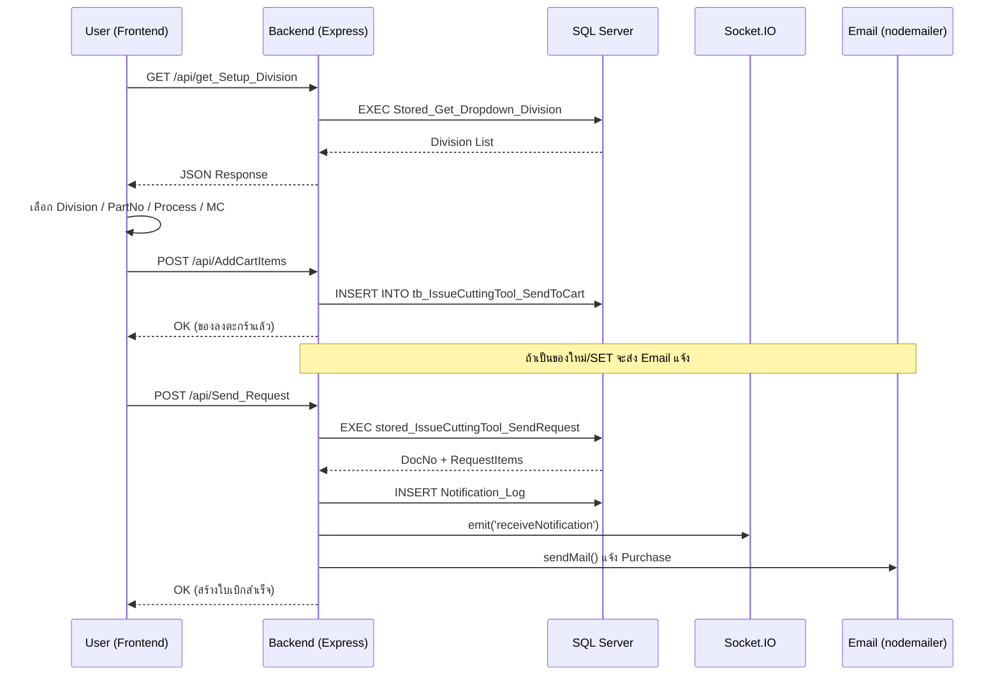
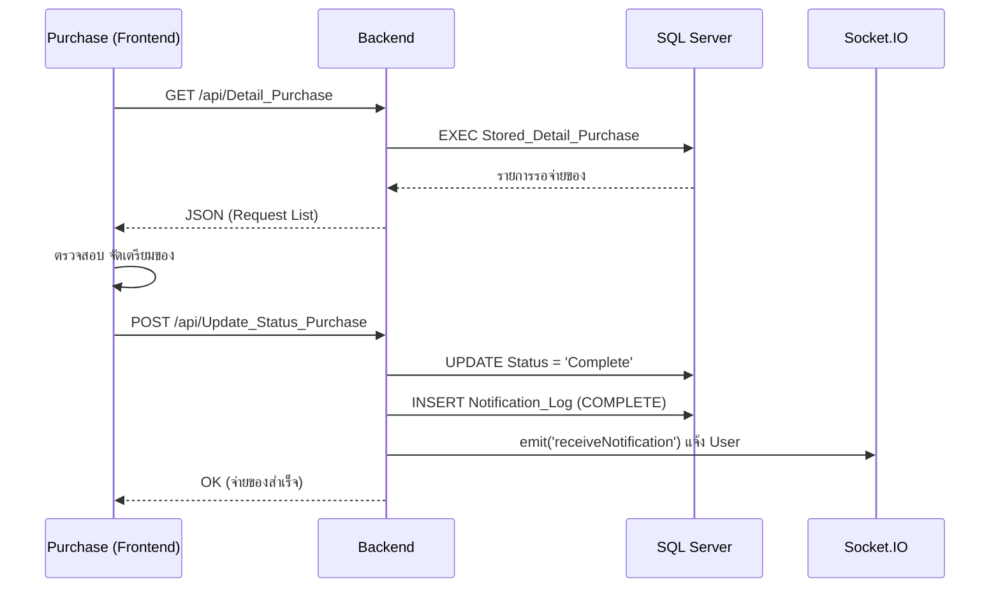
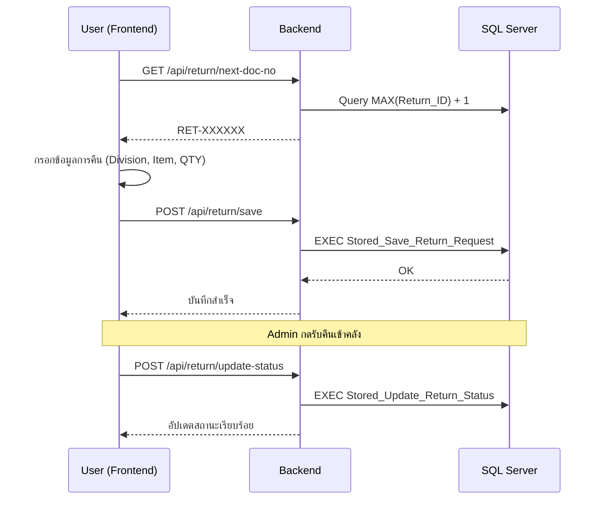
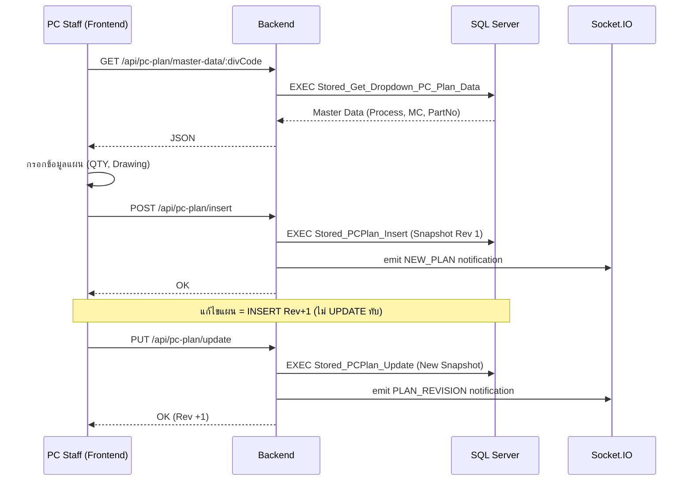
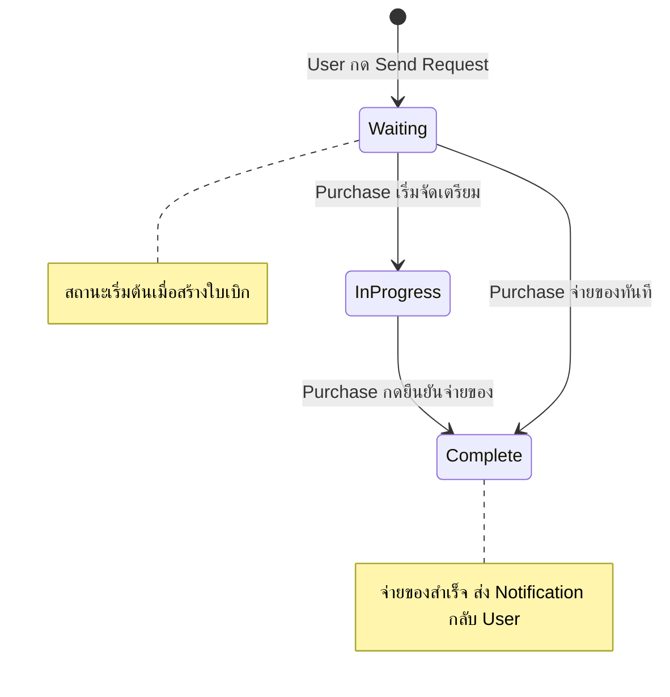
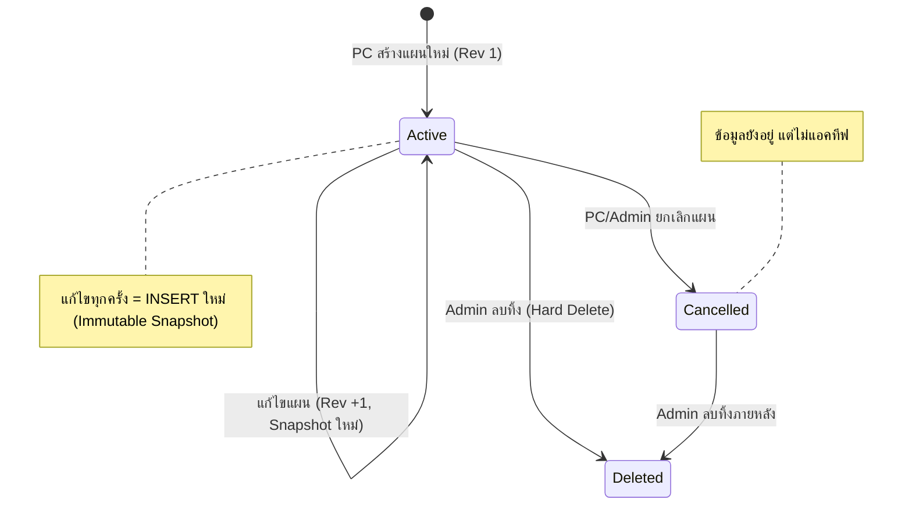
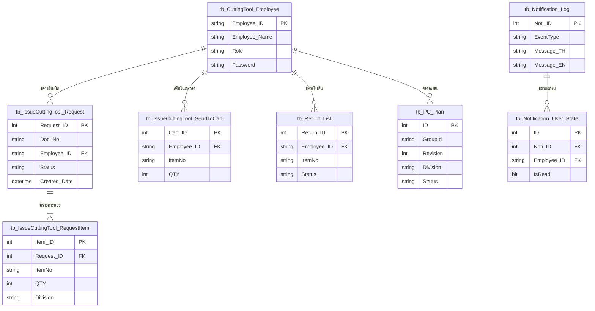
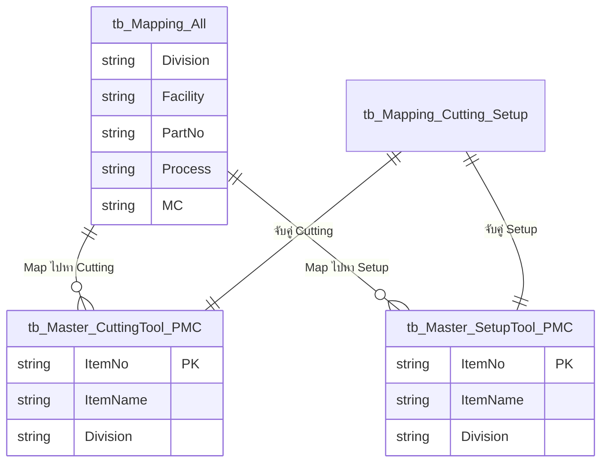
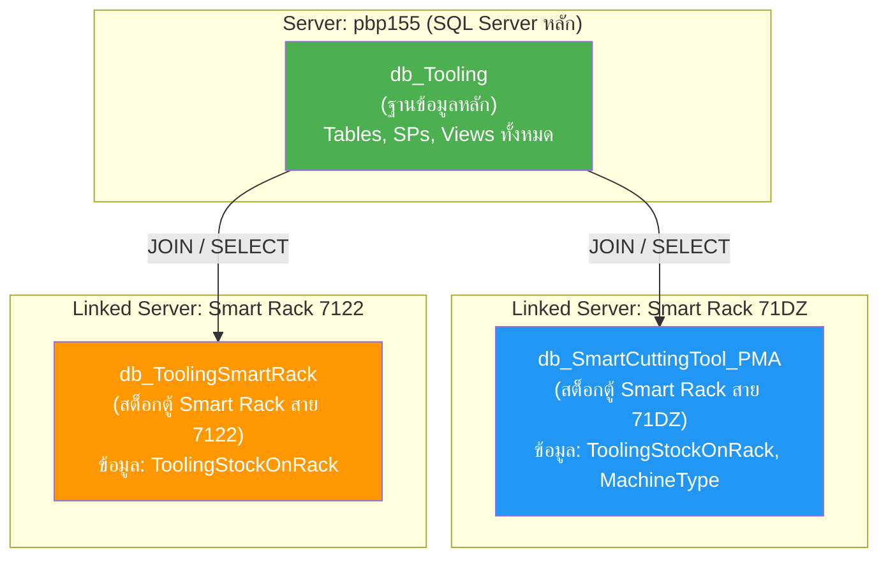
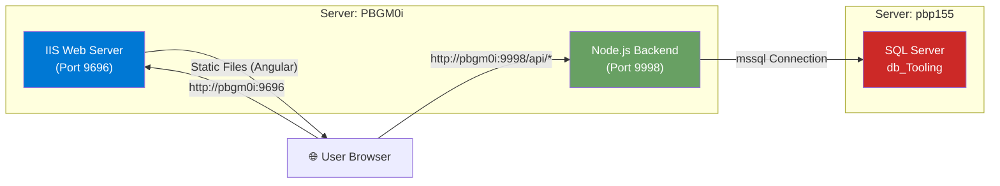

# Developer Manual

This document is a comprehensive guide for developers working on the **Indirect Expense (Tooling)** project. It covers the architecture, data flow, and components of the system to immediately begin extending it.

## 1. GitHub Repository

| รายการ | รายละเอียด |
| :--- | :--- |
| **Repository URL** | [https://github.com/Kaoji1/Tooling](https://github.com/Kaoji1/Tooling) |
| **Branch หลัก** | `main` |
| **Visibility** | 🔒 **Private** — ต้องได้รับสิทธิ์เป็น Collaborator ก่อนจึงจะเข้าถึงได้ |

### 1.1 วิธี Clone โปรเจคมาทำงาน

```bash
# Clone Repository มาที่เครื่อง
git clone https://github.com/Kaoji1/Tooling.git

# เข้าโฟลเดอร์โปรเจค
cd Tooling
```

### 1.2 การขอสิทธิ์เข้าถึง (สำหรับ Developer ใหม่)

เนื่องจาก Repository เป็น **Private** ผู้ที่ต้องการเข้าถึงจะต้อง:

1. สร้างบัญชี GitHub (ถ้ายังไม่มี)
2. แจ้ง **Username** หรือ **Email** ให้เจ้าของ Repository เพิ่มเป็น Collaborator
3. ตรวจสอบ Email เพื่อกด **Accept Invitation**
4. หลังจากนั้นจะสามารถ Clone, Push, Pull ได้ตามปกติ

> [!IMPORTANT]
> **ห้าม** commit ไฟล์ `.env` หรือไฟล์ที่มีรหัสผ่านขึ้น GitHub เด็ดขาด! ตรวจสอบให้แน่ใจว่า `.gitignore` มีการยกเว้นไฟล์เหล่านี้อยู่แล้ว

### 1.3 Git Workflow พื้นฐาน

```bash
# ดึงโค้ดล่าสุดก่อนเริ่มทำงาน
git pull origin main

# หลังแก้โค้ดเสร็จ
git add .
git commit -m "คำอธิบายสั้นๆ ว่าแก้อะไร"
git push origin main
```

---

## 2. การติดตั้งและรันระบบ (Setup & Run)

หน้านี้อธิบายขั้นตอนการติดตั้งสภาพแวดล้อมและการรันระบบทั้งในเครื่อง Developer และการเตรียมตัวเพื่อขึ้นโปรดักชัน

### 1.1 Backend

```bash
cd backend
npm install
# แก้ไขไฟล์ .env ให้ตรงกับ Server (Database, Email, Port)

# สำหรับโหมด Development (รันด้วย nodemon ระบบจะ Auto-reload เมื่อแก้โค้ด)
npm run dev

# หรือหากต้องการรันตามปกติ/สำหรับ Production
npm start
```

*ระบบ Backend จะรันที่พอร์ต **3000** และจะแสดงข้อความ `"Connected to SQL Server"` เมื่อเชื่อมต่อสำเร็จ*

### 1.2 Frontend

```bash
cd Frontend
npm install
# ตรวจสอบการอ้างอิง API ใน src/app/core/services/ (ปรับ URL ตามเครื่องจริง)
ng serve
```

*ระบบ Frontend จะทำงานที่ `http://localhost:9696`*

### 1.3 Production Build

สำหรับการเตรียมไฟล์เพื่อนำไป Deploy บน Web Server (เช่น IIS หรือ Nginx):

```bash
ng build --configuration production
```

*ไฟล์ที่ Build สำเร็จจะอยู่ในโฟลเดอร์ `dist/`*

### 2.4 Dependencies สำคัญที่ใช้งานจริง (Filtered)

จากการสแกน Source Code นี่คือรายการ Library ที่มีการ **เรียกใช้งานจริงๆ** ในโปรเจคปัจจุบัน:

#### Backend Dependencies (Used)

| Package | Version | หน้าที่ |
| :--- | :--- | :--- |
| **express** | ^5.1.0 | Web Server Framework หลัก |
| **mssql** | ^11.0.1 | SQL Server Driver สำหรับเชื่อมต่อฐานข้อมูล |
| **socket.io** | ^4.8.1 | Real-time Communication (Notification) |
| **dotenv** | ^17.2.3 | จัดการ Environment Variables จากไฟล์ `.env` |
| **cors** | ^2.8.5 | จัดการ Cross-Origin Resource Sharing |
| **body-parser** | ^2.2.0 | Parse ข้อมูล JSON จาก HTTP Request Body |
| **multer** | ^2.0.2 | Middleware สำหรับอัปโหลดไฟล์ (Multipart/form-data) |
| **express-fileupload** | ^1.5.2 | รองรับการอัปโหลดไฟล์ (Buffer mode) |
| **formidable** | ^3.5.4 | Parse ข้อมูล Form-data (ไฟล์อัปโหลด) |
| **xlsx** | ^0.18.5 | อ่าน/เขียนไฟล์ Excel (.xlsx) |
| **sequelize** | ^6.37.7 | ORM สำหรับจัดการฐานข้อมูล (ใช้บางส่วน) |

*(หมายเหตุ: Library อย่าง `nodemailer`, `bcryptjs`, `jsonwebtoken` มีอยู่ใน `package.json` แต่ปัจจุบันยังไม่มีหน้าโค้ดไหนเรียกใช้)*

#### Frontend Dependencies (Used)

| Package | Version | หน้าที่ |
| :--- | :--- | :--- |
| **@angular/core** | ^18.2.13 | Core Framework หลัก |
| **@angular/material** | ^18.2.13 | UI Components (Table, Dialog, Snackbar, Input) |
| **@angular/cdk** | ^18.2.13 | Component Dev Kit (ใช้ร่วมกับ Material) |
| **@angular/forms** | ^18.2.0 | จัดการ Reactive Forms และ Template Forms |
| **@angular/router** | ^18.2.0 | จัดการ Routing (เปลี่ยนหน้า) |
| **bootstrap** | ^5.3.7 | CSS Framework (โหลดผ่าน `angular.json`) |
| **bootstrap-icons** | ^1.13.1 | ไอคอนจาก Bootstrap (โหลดผ่าน `angular.json`) |
| **primeng** | ^18.0.2 | UI Components เสริม (Calendar, Dropdown) |
| **primeicons** | ^7.0.0 | ไอคอนสำหรับ PrimeNG |
| **ng2-charts** | ^7.0.0 | Angular Wrapper สำหรับ Chart.js |
| **chart.js** | ^4.5.1 | ไลบรารีสร้างกราฟ |
| **chartjs-plugin-datalabels** | ^2.2.0 | แสดงค่าตัวเลขบนกราฟ |
| **sweetalert2** | ^11.6.13 | Popup แจ้งเตือน |
| **@ng-select/ng-select** | ^13.0.2 | Dropdown พร้อมระบบค้นหา |
| **xlsx** | ^0.18.5 | อ่านไฟล์ Excel |
| **exceljs** | ^4.4.0 | สร้างและจัดการไฟล์ Excel |
| **file-saver** | ^2.0.5 | ดาวน์โหลดไฟล์จาก Browser (Save As) |
| **html2canvas** | ^1.4.1 | จับภาพหน้าจอ HTML |
| **socket.io-client** | ^4.8.1 | เชื่อมต่อ Socket.IO ฝั่ง Client |
| **rxjs** | ~7.8.0 | Reactive Extensions |

### 1.5 การตั้งค่า Environment Variables

การตั้งค่าตัวแปรสภาพแวดล้อมเป็นสิ่งสำคัญเพื่อให้ระบบรับส่งข้อมูลและเชื่อมต่อกับฐานข้อมูลได้อย่างถูกต้อง โปรดตรวจสอบหรือสร้างไฟล์ดังรายละเอียดด้านล่างก่อนเริ่มรันระบบ:

**Backend (`backend/.env`):**
สำหรับตั้งค่า Database SQL Server, กำหนด Port ของระบบ Backend และตั้งค่าความปลอดภัยต่างๆ (ไฟล์นี้เป็น Secret ห้ามนำขึ้น Git)
ตัวอย่างการตั้งค่าสำหรับ Server `PBGM0i`:

```env
# ไฟล์ .env (เก็บความลับ)
EMAIL_USER=testsystem1508@gmail.com
EMAIL_PASS=your_email_password
FRONTEND_URL=http://pbgm0i:9696
DB_USER_APP=Cost_Team
DB_PASSWORD=your_sql_password
DB_SERVER=pbp155
DB_NAME=db_Tooling
PORT=9998
```

*(ถ้า Run ในเครื่องตัวเอง `PORT` มักจะเป็น `3000` และ `FRONTEND_URL` จะเป็น `http://localhost:9696`)*

**Frontend (`src/environments/environment.ts`):**
เพื่อให้ Frontend เชื่อมต่อกับ Backend ได้ถูกต้อง ควรกำหนด Base URL ให้สอดคล้องกับ Server ที่ Backend รันอยู่:

```typescript
export const environment = {
  production: false,
  // ปกติถ้า Run Backend ในเครื่องตัวเองจะใช้ localhost (เช่น http://localhost:3000/api)
  // แต่ถ้ารันผ่าน Server PBGM0i ให้ใช้พอร์ต 9998 ดังนี้:
  apiUrl: 'http://pbgm0i:9998/api',
  socketUrl: 'http://pbgm0i:9998'

  // 💡 หมายเหตุ: ถ้าคุณต้องการให้ตอนเขียนโค้ด (ng serve) 
  // มันยิงไปหา Server PBGM0i ตลอด ก็ให้แก้บรรทัดบนเป็น:
  // apiUrl: 'http://pbgm0i:9998/api'
};
```

*คำแนะนำ: สำหรับการทำ Production Build (`ng build`) แนะนำให้แก้ไขที่ไฟล์ฝั่ง Production (`environment.prod.ts`) เพื่อให้ชี้ไปยัง IP หรือ Domain Name ของ Server จริงอย่างถูกต้อง*

---

## 2. ภาพรวมโปรเจค (Project Overview & Tech Stack)

ระบบ Indirect Expense (Tooling) เป็นแอปพลิเคชันสำหรับจัดการ ตรวจสอบ และติดตามข้อมูลค่าใช้จ่ายที่เกี่ยวข้องกับเครื่องมือ (Tooling) มีการแบ่งสิทธิ์การใช้งาน (เช่น PC, Purchase, User) พร้อมระบบ Dashboard และการออกรายงานแบบ Real-time

**Tech Stack:**

| Layer | Technology | รายละเอียด |
| :--- | :--- | :--- |
| **Frontend** | Angular v18 (Standalone) | Angular v18+ ใช้ Standalone Components เป็นหลัก ไม่ต้องพึ่งพา NgModule |
| **Styling** | Bootstrap 5 + Angular Material | Utility-first CSS framework และ UI components สำเร็จรูป |
| **Charts** | ng2-charts + Chart.js, Highcharts | กราฟแท่ง กราฟเส้น สำหรับ Data Visualization และ Dashboard |
| **Backend** | Node.js + Express.js | REST API Server รันเป็น Backend หลัก |
| **Database** | Microsoft SQL Server | ฐานข้อมูลหลัก (Primary relational database) เชื่อมต่อผ่าน mssql library |
| **Real-time**| Socket.IO | สำหรับการทำงานและแจ้งเตือนแบบ Real-time |
| **Export** | xlsx, exceljs, html2canvas | Export ข้อมูลเป็นไฟล์ .xlsx และสร้าง Document |

<br/>

## 2.2 ฟีเจอร์หลักของระบบ (Key Features)

จากโครงสร้างและ Routing ([app.routes.ts](file:///c:/Users/bptj861/Desktop/Indirect-Expense/Frontend/src/app/app.routes.ts)) รวมถึง API ในระบบ ระบบถูกออกแบบมาให้รองรับผู้ใช้งานหลายระดับ (Roles) และมีฟีเจอร์หลัก ได้แก่

* **Production / User**
  * `PCPlan` / `PlanList`: หน้าดูแผนงานของฝ่าย PC
  * `request`: หน้าสำหรับเบิกอุปกรณ์ (Request)
  * `cart`: ตะกร้าสินค้าสำหรับตรวจสอบรายการเบิก
  * `return`: หน้าสำหรับคืนอุปกรณ์
  * `request-history` / `return-history`: ดูประวัติการเบิกและประวัติการคืน
* **Purchase / Admin**
  * `detail` / `detailcasesetup`: จัดการและอนุมัติการเบิก (Approve Request) เฉพาะ Tooling และ Case Setup
  * `returnlist`: จัดการและอนุมัติการคืน (Approve Return)
  * `analyze` / `analyzeSmartRack`: หน้า Dashboard สำหรับวิเคราะห์ข้อมูลค่าใช้จ่ายและข้อมูลที่เกี่ยวข้องกับ Smart Rack
  * `master-ph`: หน้าสำหรับจัดการ Master Data
  * `add-user`: ระบบเพิ่ม/จัดการผู้ใช้งาน (สิทธิ์ Admin)
* **Real-time Notification**
  * ระบบการแจ้งเตือนสถานะต่างๆ (เช่น อนุมัติสำเร็จ, รอดำเนินการ) แบบ Real-time ผ่านการส่งข้อมูลด้วย Socket.IO

<br/>

## 2.3 โครงสร้างโฟลเดอร์ (File Structure)

```text
Indirect-Expense/
├── backend/                  
│   ├── src/
│   │   ├── config/           <- การตั้งค่าและการเชื่อมต่อฐานข้อมูล (Database Connection)
│   │   ├── controllers/      <- โลจิกของการทำงานในแต่ละ API
│   │   └── routes/           <- กำหนด URL Routes สำหรับให้ Frontend เรียกใช้ API
│   ├── sql/                  <- ไฟล์ Script SQL สำหรับสร้างและจัดการ Database
│   ├── server.js             <- Backend หลัก (Express API Entry Point)
│   └── .env                  <- ตัวแปรสภาพแวดล้อม (Secret, DB Credentials)
└── Frontend/                 
    ├── src/
    │   ├── app/
    │   │   ├── components/   <- UI Components ที่ใช้ซ้ำได้ในหลายๆ ส่วน
    │   │   │   ├── dropdown-search/ <- คอมโพเนนต์สำหรับค้นหาในเมนูดรอปดาวน์
    │   │   │   ├── notification/    <- คอมโพเนนต์สำหรับแสดงการแจ้งเตือน
    │   │   │   └── sidebar/         <- แถบเมนูด้านข้างระบบ
    │   │   ├── core/         <- Core logic ของระบบ
    │   │   │   ├── guards/       <- ตรวจสอบสิทธิ์และควบคุมคุกกี้ / Route
    │   │   │   ├── interceptors/ <- แทรก Token และจัดการ HTTP Request
    │   │   │   └── services/     <- โลจิกหลักในการเรียก API และจัดการข้อมูล
    │   │   ├── pages/        <- หน้าจอหลักต่างๆ ของระบบ
    │   │   │   ├── PC/       <- โมดูลหน้าของฝั่งแผนก PC
    │   │   │   │   ├── PCPlan/      <- วางแผนและบันทึกข้อมูลยอดการผลิต
    │   │   │   │   └── PlanList/    <- ดูรายการแผนงานทั้งหมดที่บันทึกไว้
    │   │   │   ├── login/    <- หน้าเข้าสู่ระบบ (Authentication)
    │   │   │   ├── purchase/ <- โมดูลหน้าของฝั่งฝ่ายจัดซื้อ/Admin
    │   │   │   │   ├── MasterPH/    <- จัดการ Master Data สำหรับ Tooling 
    │   │   │   │   ├── add-user/    <- เพิ่ม/จัดการข้อมูลผู้ใช้งานและสิทธิ์
    │   │   │   │   ├── analyze/     <- Dashboard วิเคราะห์ค่าใช้จ่าย Tooling
    │   │   │   │   ├── analyzeSmartrack/ <- Dashboard ข้อมูลการใช้ Smart Rack
    │   │   │   │   ├── detail/      <- หน้าตรวจสอบและอนุมัติใบเบิก Cutting Tool
    │   │   │   │   ├── detailcasesetup/ <- หน้าตรวจสอบและอนุมัติใบเบิก Case Setup
    │   │   │   │   ├── history-request/ <- ประวัติการเบิกอุปกรณ์
    │   │   │   │   └── returnlist/  <- หน้าตรวจสอบและจัดการการคืนอุปกรณ์
    │   │   │   └── user/     <- โมดูลหน้าของฝั่ง Production/ผู้ใช้งานทั่วไป
    │   │   │       ├── about-us/        <- คู่มือการใช้งานระบบ
    │   │   │       ├── cart/            <- ตะกร้าสินค้าสำหรับตรวจสอบก่อนเบิก
    │   │   │       ├── history-print/   <- ประวัติการพิมพ์เอกสาร
    │   │   │       ├── request/         <- หน้าหลักสำหรับค้นหาและเลือกเบิกอุปกรณ์
    │   │   │       ├── request-history/ <- ประวัติการเบิกอุปกรณ์ส่วนตัว
    │   │   │       ├── return/          <- หน้าหลักสำหรับคืนอุปกรณ์
    │   │   │       └── return-history/  <- ประวัติการคืนอุปกรณ์ส่วนตัว
    │   │   ├── styles/       <- ไฟล์ Global Stylesheet
    │   │   ├── app.routes.ts <- การจัดการ Routing ภายในแอปพลิเคชัน
    │   │   └── app.config.ts <- การตั้งค่า Application ระดับโครงสร้าง (Providers)
    └── package.json          <- จัดการ Dependencies ทั้งหมดของ Frontend
```

<br/>

## 3. Routing — เส้นทางหน้าเว็บ (app.routes.ts)

ไฟล์ [src/app/app.routes.ts](file:///c:/Users/bptj861/Desktop/Indirect-Expense/Frontend/src/app/app.routes.ts) กำหนดเส้นทางทั้งหมดในแอป มีการใช้ `AuthGuard` ควบคุมสิทธิ์การเข้าถึงในหลายหน้า

| Path (URL) | Component | หน้าที่ |
| :--- | :--- | :--- |
| `/` (root) | `redirectTo: 'login'` | Redirect ไปหน้า Login |
| `/login` | `LoginComponent` | หน้า Login สำหรับเข้าสู่ระบบ |
| **Production Role** | | *(สิทธิ์เข้าถึง: production, view, admin, engineer, PC, QC, Gague, Cost)* |
| `/production/PCPlan` | `PCPlanComponent` | จัดการแผนงาน PC (เฉพาะ PC, admin) |
| `/production/PlanList` | `PlanListComponent` | หน้าดูแผนงานรวม |
| `/production/request` | `requestComponent` | หน้าสำหรับเบิกอุปกรณ์ (เฉพาะ production, admin) |
| `/production/cart` | `CartComponent` | ตะกร้าสินค้าสำหรับยืนยันการเบิก |
| `/production/return` | `ReturnComponent` | หน้าสำหรับคืนอุปกรณ์ (เฉพาะ production, admin) |
| `/production/request-history` | `RequestHistoryComponent` | หน้าดูประวัติการเบิกอุปกรณ์ |
| `/production/about-us` | `AboutUsComponent` | หน้าเกี่ยวกับระบบและคู่มือ |
| `/production/historyprint` | `HistoryPrintComponent` | พิมพ์ประวัติการทำรายการต่างๆ |
| `/production/return-history` | `ReturnHistoryComponent` | ดูประวัติการคืนอุปกรณ์ |
| **Purchase Role** | | *(สิทธิ์เข้าถึง: purchase, view, admin, Cost)* |
| `/purchase/PlanList` | `PlanListComponent` | ดูแผนงาน (มุมมอง Purchase) |
| `/purchase/detail` | `DetailComponent` | หน้าจัดการและอนุมัติการเบิก Tooling |
| `/purchase/detailcasesetup` | `DetailCaseSetupComponent`| หน้าจัดการและอนุมัติการเบิก Case Setup |
| `/purchase/returnlist` | `ReturnlistComponent` | หน้าจัดการและอนุมัติการคืน Tooling / Case |
| `/purchase/request-history` | `RequestHistoryComponent` | หน้าดูประวัติการเบิกอุปกรณ์ (มุมมอง Purchase) |
| `/purchase/history-request` | `HistoryRequestComponent` | ประวัติการทำรายการ (History Request) |
| `/purchase/return-history` | `ReturnHistoryComponent` | ดูประวัติการคืนอุปกรณ์ (มุมมอง Purchase) |
| `/purchase/historyprint` | `HistoryPrintComponent` | พิมพ์ประวัติการทำรายการ (มุมมอง Purchase) |
| `/purchase/add-user` | `AddUserComponent` | หน้าเพิ่มและจัดการผู้ใช้งาน (เฉพาะ purchase, admin) |
| `/purchase/analyze` | `AnalyzeComponent` | หน้า Dashboard วิเคราะห์ข้อมูล Tooling |
| `/purchase/analyzeSmartRack`| `AnalyzeSmartRackComponent`| หน้า Dashboard วิเคราะห์ข้อมูล Smart Rack |
| `/purchase/master-ph` | `MasterPHComponent` | จัดการ Master Data สำหรับ Purchase |

<br/>

## 4. Services (Angular)

บริการหลัก (Services) ในโปรเจกต์ทำหน้าที่จัดการรับ-ส่งข้อมูลกับ API, จัดการ State ของตะกร้าสินค้า และการควบคุมสิทธิ์ (Auth) ปัจจุบันมีทั้งหมด **19 Services** ครบถ้วนตามโครงสร้างโปรเจกต์ ดังนี้:

### 4.1 Authentication & User Management

**AuthService ([auth.service.ts](file:///c:/Users/bptj861/Desktop/Indirect-Expense/Frontend/src/app/core/services/auth.service.ts))**

| Method / Property | Type | หน้าที่ |
| :--- | :--- | :--- |
| `getUserRole()` | `string` | ดึง Role จาก sessionStorage |
| `getToken()` | `string` | ดึง Token สำหรับแนบไปกับ Header HTTP |
| `isAdmin() / isPC() / isEngineer() / isPD()`| `boolean` | Helpers สำหรับเช็คสิทธิ์การใช้งานในหน้าต่างๆ |

**LoginService ([Login.service.ts](file:///c:/Users/bptj861/Desktop/Indirect-Expense/Frontend/src/app/core/services/Login.service.ts))**

| Method | HTTP | หน้าที่ |
| :--- | :--- | :--- |
| `login(credentials)` | `POST /login` | ส่ง Username/Password ไปตรวจสอบสิทธิ์ที่ Backend |

**EmployeeService ([Employee.service.ts](file:///c:/Users/bptj861/Desktop/Indirect-Expense/Frontend/src/app/core/services/Employee.service.ts))**

| Method | HTTP | หน้าที่ |
| :--- | :--- | :--- |
| `get_Employee()` | `GET /get_Employee` | ดึงข้อมูลพนักงานทั้งหมด |
| `addEmployee(data)` | `POST /AddEmployee` | ลงทะเบียนพนักงานใหม่ |
| `updateEmployee(data)` | `POST /update/:id` | แก้ไขข้อมูลพนักงาน (Role, Password) |
| `deleteEmployee(id)` | `DELETE /delete_employee/:id`| ลบพนักงานออกจากระบบ |

<br/>

### 4.2 Core Workflow (Request & Sales Shopping)

**RequestService ([request.service.ts](file:///c:/Users/bptj861/Desktop/Indirect-Expense/Frontend/src/app/core/services/request.service.ts))**

| Method | HTTP | หน้าที่ |
| :--- | :--- | :--- |
| `get_Division()` | `GET /get_Division` | ดึงรายชื่อแผนก (พร้อมระบบ Cache) |
| `get_PartNo(data)` | `POST /get_PartNo` | ค้นหา Part Number ตามเงื่อนไข |
| `get_Process(data)` | `POST /get_Process` | ค้นหา Process ตามเงื่อนไข |
| `get_MC(data)` | `POST /get_MC` | ค้นหา Machine ตามเงื่อนไข |
| `post_ItemNo(data)` | `POST /post_ItemNo`| ค้นหา ItemNo (เลขเครื่องมือ) จากเครื่องมือกดค้นหา |
| `get_Setup_Items(data)` | `POST /get_Setup_Items`| ค้นหารายการ Setup Tools |
| `get_CaseSET_All(data)`| `POST /get_CaseSET_All`| ดึงข้อมูล Case SET (รวม Cutting + Setup) |

**CartService ([cart.service.ts](file:///c:/Users/bptj861/Desktop/Indirect-Expense/Frontend/src/app/core/services/cart.service.ts))**

| Method | HTTP | หน้าที่ |
| :--- | :--- | :--- |
| `getCartFromDB()` | `GET /get_cart` | ดึงรายการในตะกร้าปัจจุบันของผู้ใช้ |
| `addCartToDB(data)` | `POST /AddCartItems`| เพิ่มรายการใหม่ลงตะกร้า (Database Storage) |
| `updateMultipleItemsInDB`| `POST /update_cart_items`| แก้ไข QTY หรือข้อมูลในตะกร้าแบบกลุ่ม |
| `removeItemFromDB(id)` | `DELETE /delete_cart_item/:id`| ลบของในตะกร้าทีละรายการ |
| `clearAllFromDB()` | `DELETE /clear_cart` | ล้างตะกร้าทั้งหมด |

**SendrequestService ([SendRequest.service.ts](file:///c:/Users/bptj861/Desktop/Indirect-Expense/Frontend/src/app/core/services/SendRequest.service.ts))**

| Method | HTTP | หน้าที่ |
| :--- | :--- | :--- |
| `SendRequest(data)` | `POST /Send_Request`| ยืนยันการส่งใบเบิก → สร้าง DocNo และบันทึกเข้าระบบ |
| `GenerateNewDocNo(...)` | `POST /GenerateNewDocNo`| ขอเลขเอกสารใบเบิกล่วงหน้า |

<br/>

### 4.3 Management & Planning (Purchase & PC)

**DetailPurchaseRequestlistService ([DetailPurchaseRequestlist.service.ts](file:///c:/Users/bptj861/Desktop/Indirect-Expense/Frontend/src/app/core/services/DetailPurchaseRequestlist.service.ts))**

| Method | HTTP | หน้าที่ |
| :--- | :--- | :--- |
| `Detail_Request()` | `GET /Detail_Purchase`| รายการ Cutting Tool ที่รอจ่ายของ |
| `Detail_Request_Setup()`| `GET /Detail_Purchase_Setup`| รายการ Setup Tool ที่รอจ่ายของ |
| `updateStatusToComplete`| `POST /Update_Status_Purchase`| ยืนยันการจ่ายของ (Complete) |
| `updateRequest(data)` | `PUT /Update_Request` | แก้ไขข้อมูลใบเบิก (MatLot, QTY) |
| `insertRequestBulk(data)`| `POST /Insert_Request_Bulk`| เพิ่มรายการเบิกเข้าระบบโดยตรง |

**ReturnService ([return.service.ts](file:///c:/Users/bptj861/Desktop/Indirect-Expense/Frontend/src/app/core/services/return.service.ts))**

| Method | HTTP | หน้าที่ |
| :--- | :--- | :--- |
| `saveReturnRequest(data)`| `POST /return/save` | บันทึกการรับคืนอุปกรณ์ (Transaction) |
| `getReturnHistory()` | `GET /return/list` | รายการประวัติการคืนของ |
| `getNextDocNo(...)` | `GET /return/next-doc-no`| ขอเลขที่ใบส่งคืน (RET-...) |
| `updateReturnStatus(data)`| `POST /return/update-status`| PH กดยืนยันการรับคืนของ |

**PCPlanService ([PCPlan.service.ts](file:///c:/Users/bptj861/Desktop/Indirect-Expense/Frontend/src/app/core/services/PCPlan.service.ts))**

| Method | HTTP | หน้าที่ |
| :--- | :--- | :--- |
| `getDivisions()` | `GET /pc-plan/divisions`| รายชื่อ Division ทั้งหมดสำหรับการวางแผน |
| `getMasterData(div, mode)`| `GET /pc-plan/master-data/`| ดึงข้อมูล Master สำหรับฝ่าย PC |
| `getPlanList()` | `GET /pc-plan/list` | รายการแผนงานปัจจุบัน |
| `savePlan(data)` | `POST /pc-plan/insert`| บันทึกแผนงานใหม่ |
| `updatePlan(data)` | `PUT /pc-plan/update` | อัปเดตข้อมูลแผน |
| `cancelPlan(id)` | `PUT /pc-plan/cancel/:id`| ยกเลิกแผนงาน |
| `deletePlan(id)` | `DELETE /pc-plan/delete/:id`| ลบแผนงานถาวร |

**MasterPHService ([MasterPH.service.ts](file:///c:/Users/bptj861/Desktop/Indirect-Expense/Frontend/src/app/core/services/MasterPH.service.ts))**

| Method | HTTP | หน้าที่ |
| :--- | :--- | :--- |
| `getAllValues(type)` | `GET /master-ph` | ดึงข้อมูล Master PH (PMC/GM) |
| `importData(data)` | `POST /master-ph/import`| นำเข้าข้อมูล Excel ต้นทาง |
| `syncMasterToolingGM()` | `POST /master-ph/sync-gm`| ประมวลผลและซิงค์ข้อมูล Master |

<br/>

### 4.4 Dashboards & History Reports

**Analyze & Smart Rack Services**

| Service | Method | หน้าที่ |
| :--- | :--- | :--- |
| `Analyze` | `getcostanalyze()` | วิเคราะห์ค่าใช้จ่าย Tooling (Chart) |
| `AnalyzeSmartRack`| `getdatasmartrack()` | สถิติการใช้งานตู้ Smart Rack |

**History Services**

| Service | Method | หน้าที่ |
| :--- | :--- | :--- |
| `PurchaseRequest` | `Purchase_Request()` | รายการใบเบิกทั้งหมด (Request List) |
| `PurchaseHistory` | `Purchase_History()` | ประวัติใบเบิกที่ดำเนินการแล้ว |
| `UserHistory` | `User_History()` | ประวัติการเบิกรายพนักงาน |

**HistoryPrint ([HistoryPrint.service.ts](file:///c:/Users/bptj861/Desktop/Indirect-Expense/Frontend/src/app/core/services/HistoryPrint.service.ts))**

| Method | HTTP | หน้าที่ |
| :--- | :--- | :--- |
| `EmpPrint()` | `GET /emp-print` | รายชื่อพนักงานที่มีสิทธิ์ Print |
| `checkPrintPermission` | `GET /check-print-permission`| ตรวจสอบสิทธิ์ก่อนพิมพ์ |
| `SaveHistoryPrint(data)`| `POST /SaveHistoryPrint`| บันทึกประวัติการสั่งพิมพ์เอกสาร |

<br/>

### 4.5 System Utilities & Real-time (Socket.IO)

ระบบใช้ **Socket.IO** ในการทำ **Real-time Notification (Push Notification)**

* **Socket.IO คืออะไร?** ปกติการส่งข้อมูลแบบ HTTP (REST API) ฝั่งเว็บ (Frontend) ต้องเป็นฝ่าย "ร้องขอ (Request)" ไปหาเซิร์ฟเวอร์ก่อนเสมอถึงจะได้ข้อมูลกลับมา แต่ Socket.IO ช่วยสร้าง "ท่อเชื่อมต่อถาวร" (WebSocket) ทำให้เซิร์ฟเวอร์สามารถ **"ผลัก (Push)"** ข้อมูลหรือแจ้งเตือนมายังหน้าจอของผู้ใช้งานได้ทันทีโดยที่ผู้ใช้ไม่ต้องกด Refresh หน้าเว็บ (เช่น เวลามีใบเบิกใหม่เด้งเข้ามา หรือของถูกอนุมัติแล้ว)

**NotificationService ([notification.service.ts](file:///c:/Users/bptj861/Desktop/Indirect-Expense/Frontend/src/app/core/services/notification.service.ts))**

| Method / Property | Type | หน้าที่ |
| :--- | :--- | :--- |
| `notifications$` | `Observable` | Stream ข้อมูลแจ้งเตือนแบบเรียลไทม์ |
| `fetchNotifications()` | `GET /notifications/list`| โหลดแจ้งเตือนย้อนหลังจาก Database |
| `markAsRead(id)` | `PUT /notifications/read/:id`| เปลี่ยนสถานะแจ้งเตือนเป็นอ่านแล้ว |
| `socket.on('notification')`| `Socket.IO` | ดักฟัง Event แจ้งเตือนจาก Backend |

**FileUpload & FileRead Services**

| Service | Method | หน้าที่ |
| :--- | :--- | :--- |
| `FileUpload` | `FileUpload(file, key)`| อัปโหลดไฟล์ (PDF/Image) เข้าเซิร์ฟเวอร์ |
| `FileUpload` | `GetImage(caseKey)` | ดึงรูปภาพอุปกรณ์มาแสดง |
| `FileRead / FileUpload`| `loadPdfFromPath` | อ่านไฟล์ Document จาก path ที่ระบุบน Server |

---
> 📝 **สรุป:** ข้อมูล Services ทั้งหมด **19 ไฟล์** ถูกตรวจสอบและรวบรวมไว้จำแนกตามหน้าที่การทำงาน (Functionality) ครบถ้วนทุก Endpoint ในระบบ Frontend ปัจจุบันแล้ว

<br/>

## 5. Backend API Reference (server.js)

ระบบ Backend พัฒนาด้วย **Node.js (Express)** โดยใช้โครงสร้างแบบ **Route-Controller Pattern** อ้างอิงจากไฟล์หลัก `server.js` ซึ่งเป็นจุดศูนย์กลางในการจัดการ Middleware, Routing และ Socket.IO สำหรับการเชื่อมต่อแบบ Real-time

### 5.1 Server Infrastructure (`server.js`)

* **Port:** รันบนพอร์ตจาก Environment variable หรือ Default `3001`
* **CORS:** รองรับการเชื่อมต่อจาก Frontend URL ที่ระบุใน `FRONTEND_URL`
* **Middleware:**
  * `body-parser`: จัดการข้อมูล JSON request
  * `express-fileupload`: รองรับการส่งไฟล์ (Buffer mode)
  * `express.static`: ให้บริการไฟล์ Static สำหรับการแสดงผล PDF/Image เบื้องต้น
* **Socket.IO:** รวมเข้ากับ HTTP Server เพื่อใช้สำหรับระบบ **Real-time Notifications**

---

### 5.2 Backend Controllers (Business Logic)

ตัวจัดการกระบวนการหรือ Business logic หลักอยู่ที่โฟลเดอร์ `backend/src/controllers/` ประกอบไปด้วย **19 ไฟล์** ซึ่งทำงานสอดคล้องกับ Services ในส่วนต่างๆ ดังนี้:

**1. Authentication & Users**

* `Login.controller.js`: ตรวจสอบรหัสผ่านผ่าน Active Directory หรือตารางพนักงาน และออกลอกอิน JWT Token
* `Employee.controller.js`: จัดการรายชื่อและสิทธิ์ของพนักงาน (เพิ่ม/ลบ/แก้ไขข้อมูล)

**2. Core Workflow (Request & Sales Shopping)**

* `Itemlist.controller.js`: ดึงข้อมูล Master ไว้ทำ Lookup/Dropdown (เช่น Division, PartNo, Process, MC)
* `ItemDetail.controller.js`: ดึงรายละเอียดของ Tooling หรือรายการเฉพาะเจาะจง
* `Cart.controller.js`: จัดการข้อมูลในตะกร้าสินค้า (Add, Update QTY, ลบทีละรายการ หรือล้างตะกร้า)
* `SendRequest.controller.js`: ควบคุมการสร้างใบเบิก, ออกเลข Document (DocNo) และบันทึกเข้าระบบ

**3. Management & Planning (Purchase & PC)**

* `DetailPurchaseRequestlist.controller.js`: จัดการสถานะการรอคิวจ่ายของและการอนุมัติของฝ่ายจัดซื้อ
* `Return.controller.js`: การเชื่อมต่อและลงบันทึกการเคลียร์ของและคืนเข้าคลัง
* `PCPlan.controller.js`: โลจิกสำหรับการวางแผนการผลิต ดึงและบันทึกข้อมูล Master Data หรือ Snapshot ต่างๆ
* `MasterPH.controller.js`: จัดการวงจรระบบ Import/Sync ค่า Master Data จากไฟล์ Excel (Parallel batching)

**4. Dashboards & History**

* `analyze.controller.js` / `analyzeSmartRack.controller.js`: คิวรีและจัดหมวดหมู่ข้อมูลต้นทุนและตู้ Smart Rack มาตีกราฟ
* `PurchaseRequest.controller.js` / `PurchaseHistory.controller.js` / `Userhistory.controller.js`: API คิวรีดึงประวัติการเบิกตามระดับและสิทธิ์การเข้าถึงของผู้ใช้งาน
* `HistoryPrint.controller.js`: เก็บ Log และเช็คสิทธิ์บุคคลที่มีความสามารถในการพิมพ์เอกสาร

**5. Utilities & Services**

* `Notification.controller.js`: ควบคุมข้อมูลประวัติและจัดการสถานะ (อ่าน/ไม่อ่าน) แจ้งเตือนของผู้ใช้
* `FileUpload.controller.js` / `FileRead.controller.js`: อัปโหลดรูป เขียนไฟล์ลงเซิร์ฟเวอร์ และสตรีมมิ่งไฟล์ PDF สำหรับคู่มือ

---

### 5.3 API Categories & Endpoints

#### 5.2.1 Authentication & Security (`Login.route.js`)

| Method | Path | Controller | Logic / Stored Procedure |
| :--- | :--- | :--- | :--- |
| `POST` | `/api/login` | `Login` | ตรวจสอบรหัสผ่านผ่าน `stored_Find_CuttingTool_Employee` สร้าง **JWT Token** กลับไป |

#### 5.2.2 Employee & User Management (`Employee.route.js`)

| Method | Path | Controller | หน้าที่ / Stored Procedure |
| :--- | :--- | :--- | :--- |
| `GET` | `/api/get_Employee` | `ShowUser` | ดึงรายชื่อพนักงาน (`Stored_Get_AllEmployees`) |
| `POST` | `/api/AddEmployee` | `AddUser` | เพิ่มผู้ใช้งานใหม่ (`Stored_Insert_tb_CuttingTool_Employee`) |
| `DELETE`| `/api/delete_employee/:id`| `DeleteEmployee`| ลบผู้ใช้งานออกจากระบบ |
| `PUT` | `/api/update/:id`| `updateEmployee`| อัปเดตข้อมูลพนักงาน (รองรับการเปลี่ยน Password) |

#### 5.2.3 Core Workflow: Lookups & Item Lists (`Request.route.js`)

ใช้สำหรับการดึงข้อมูล Dropdown และรายละเอียดอุปกรณ์ ทั้ง Cutting Tools และ Setup Tools

| Method | Path | Controller (Itemlist) | Logic / รายละเอียด |
| :--- | :--- | :--- | :--- |
| `GET` | `/api/get_Setup_Division` | `get_Setup_Division` | ดึง Division สำหรับ Dropdown ข้อมูล Setup Tool |
| `POST` | `/api/get_Setup_Facility` | `get_Setup_Facility` | ดึง Facility สำหรับ Dropdown ข้อมูล Setup Tool |
| `POST` | `/api/get_CaseSET_CuttingTool_Detail`| `get_CaseSET_CuttingTool_Detail`| ดึงข้อมูลรายละเอียดกล่อง/ชั้นวางต่างๆ ของ Cutting Tool สำหรับ Case SET |
| `POST` | `/api/get_CaseSET_All` | `get_CaseSET_All` | ดึงไอเทมทั้ง Cutting และ Setup ของ Case SET คืนมาพร้อมกัน |
| `POST` | `/api/get_CaseSET_Dropdown_PartNo` | `get_CaseSET_Dropdown_PartNo` | ดึงรายชื่อพาร์ท Dropdown สำหรับ Case SET |
| `POST` | `/api/get_CaseSET_Dropdown_Process` | `get_CaseSET_Dropdown_Process` | ดึงรายชื่อกระบวนการผลิต Dropdown สำหรับ Case SET |
| `POST` | `/api/get_CaseSET_Dropdown_MC` | `get_CaseSET_Dropdown_MC` | ดึงรายชื่อเครื่องจักร Dropdown สำหรับ Case SET |
| `POST` | `/api/get_CaseSET_Dropdown_ItemNo` | `get_CaseSET_Dropdown_ItemNo` | ดึงรายชื่อ Item No (Dropdown) ของ Case SET |
| `POST` | `/api/get_MC_ByDivision` | `get_MC_ByDivision` | ดึงข้อมูลเครื่องจักรตามแผนกเท่านั้น (สำหรับแสดงผล) |
| `POST` | `/api/get_ToolingRequest_ByUniqueId`| `getToolingRequestByUniqueId` | ดึงรายการ Request ตาม Unique_Id จาก PC Plan |

#### 5.2.4 Shopping Cart Management (`Cart.route.js`)

จัดการรายการอุปกรณ์ที่ User เลือกไว้ก่อนทำการสร้างใบเบิก (Document)

| Method | Path | Controller | หน้าที่ / Notifications |
| :--- | :--- | :--- | :--- |
| `POST` | `/api/AddCartItems` | `AddCartItems` | บันทึกของลงตะกร้า (ส่ง Email หากเป็นของใหม่/SET) |
| `GET` | `/api/get_cart` | `GetCartItems` | ดึงรายการของในตะกร้าของผู้ใช้งานปัจจุบัน |
| `DELETE`| `/api/delete_cart_item/:id`| `DeleteItem` | ลบของออกจากตะกร้าทีละรายการ |
| `DELETE`| `/api/clear_cart` | `ClearAllItems` | ล้างตะกร้าสินค้าทั้งหมด |
| `DELETE`| `/api/delete_cart_items/:case_/:process/:fac`| `DeleteCartItemsByCaseProcessFac`| ลบของออกจากตะกร้าตามเงื่อนไข Case/Process/Fac |
| `POST` | `/api/update_cart_items` | `UpdateMultipleCartItems`| แก้ไขจำนวน (QTY) สินค้าหลายรายการในตะกร้า |

#### 5.2.5 Purchase & Request Lifecycle (`SendRequest.route.js`)

จัดการขั้นตอนการส่งใบเบิก, การแก้ไข และการอัปเดตสถานะ (Status Flow)

| Method | Path | Controller | Logic / Notifications |
| :--- | :--- | :--- | :--- |
| `POST` | `/api/Send_Request` | `Send_Request` | สร้างใบเบิก (`stored_IssueCuttingTool_SendRequest`) + **Notification ส่งเมล** |
| `POST` | `/api/GenerateNewDocNo`| `GenerateNewDocNo`| สร้างเลขที่เอกสารใหม่ (Auto-running number) |
| `POST` | `/api/Update_Status_Purchase`| `Update_Status_Purchase`| อัปเดตสถานะเป็น `Complete` (ส่งแจ้งเตือน User) |
| `PUT` | `/api/Update_Request` | `Update_Request` | แก้ไขข้อมูลใบเบิก (QTY, Remark, Path ไฟล์) |
| `POST` | `/api/Insert_Request` | `Add_New_Request` | เพิ่มรายการเข้าไปใน Doc เดิม (Manual Add) |
| `POST` | `/api/Insert_Request_Bulk` | `Add_New_Request_Bulk`| เพิ่มรายการเบิกเข้าระบบจำนวนมาก (Bulk Insert) |
| `DELETE`| `/api/Delete_Request/:id`| `DeleteItem` | ลบรายการออกจากใบเบิก |
| `GET` | `/api/get_ItemNo` | `Get_ItemNo` | ค้นหา Item Number หรือวัสดุแบบเจาะจง |
| `GET` | `/api/Detail_Purchase` | `Detail_Purchase` | ดึงรายการ Cutting Tool ที่รอจ่ายของ |
| `GET` | `/api/Detail_Purchase_Setup`| `Detail_Purchase_Setup`| ดึงรายการ Setup Tool ที่รอจ่ายของ |
| `GET` | `/api/Detail_CaseSetup`| `Detail_CaseSetup`| ดึงรายการ Case SET ที่รอจ่ายของ |

#### 5.2.6 Return Management (`Return.route.js`)

จัดการการคืนอุปกรณ์ (Cutting Tool Return)

| Method | Path | Controller | หน้าที่ / Logic |
| :--- | :--- | :--- | :--- |
| `GET` | `/api/return/divisions` | `getDivisions` | ข้อมูล Division Dropdown สำหรับหน้าคืนของ |
| `GET` | `/api/return/facilities/:divisionId`| `getFacilities`| ข้อมูล Facility Dropdown อ้างอิงตาม Division |
| `GET` | `/api/return/processes/:divisionId` | `getProcesses` | ข้อมูล Process Dropdown อ้างอิงตาม Division |
| `GET` | `/api/return/partno/:partNo`| `getPartNo` | ดึงข้อมูล Part Number สำหรับหน้าคืนของ |
| `GET` | `/api/return/item/:itemNo` | `getItemDetails` | ดึงรายละเอียดของ Item เพื่อแสดงในหน้าคืนของ |
| `GET` | `/api/return/next-doc-no` | `getNextDocNo` | สุ่มเลขที่ใบส่งคืนเอกสารลำดับถัดไป |
| `POST` | `/api/return/save` | `saveReturnRequest`| บันทึกรับคืนตระกูล Tooling ลงฐานข้อมูล |
| `GET` | `/api/return/list` | `getReturnList` | แสดงรายการคืนของทั้งหมด |
| `POST` | `/api/return/update-status`| `updateReturnStatus`| จัดซื้อ/แอดมินยืนยันปรับสถานะเข้าคลัง |

#### 5.2.7 PC Planning & Production Control (`PCPlan.route.js`)

จัดการแผนการผลิตที่ส่งผลต่อการคาดการณ์การใช้ Tooling

| Method | Path | Controller | Logic / Features |
| :--- | :--- | :--- | :--- |
| `GET` | `/api/pc-plan/divisions` | `getDivisions` | ดึง Division ที่มีในระบบแผน |
| `GET` | `/api/pc-plan/master-data/:divCode`| `getMasterDataByDivision`| ข้อมูล Master สำหรับประกอบการวางแผน (ตาม Division) |
| `GET` | `/api/pc-plan/history/:groupId` | `getPlanHistory` | ดึงประวัติการอัปเดตของแต่ละใบแผนงาน |
| `POST` | `/api/pc-plan/insert` | `insertPCPlan` | บันทึกแผน (Snapshot ลำดับการแก้ไข/Revision) |
| `GET` | `/api/pc-plan/list` | `getPlanList` | รายการแผนการผลิตทั้งหมด |
| `PUT` | `/api/pc-plan/update` | `updatePCPlan` | แก้ไขรายละเอียดแผนงาน |
| `POST` | `/api/pc-plan/update-paths` | `updatePaths` | แก้ไขที่เก็บไฟล์รูปหรือเอกสารของแผน |
| `PUT` | `/api/pc-plan/cancel/:id` | `cancelPCPlan` | ยกเลิกแผนตาม ID |
| `POST` | `/api/pc-plan/cancel-with-return` | `cancelWithReturn` | ยกเลิกแผนงานและคืนสถานะของอุปกรณ์กรณีพิเศษ |
| `DELETE`| `/api/pc-plan/delete/:id` | `deletePCPlan` | ลบทิ้งรายตัว (Hard Delete) |
| `DELETE`| `/api/pc-plan/delete-group/:groupId`| `deletePCPlanGroup`| เลือกลบแผนกลุ่มที่เกี่ยวข้องพร้อมกัน (Bulk Delete) |
| `POST` | `/api/pc-plan/check-complete-status`| `checkCompleteStatus`| ตรวจสอบสถานะว่าแผนได้ทำสำเร็จหรือไม่ |

#### 5.2.8 Master Data & Analysis Dashboard

| Method | Path | Controller | หน้าที่ |
| :--- | :--- | :--- | :--- |
| `GET` | `/api/master-ph` | `getAllMasterPHValues` | ดึงข้อมูล Master PH (PMC / GM) |
| `POST` | `/api/master-ph/import` | `importMasterData` | นำเข้า Master Data จาก Excel (Parallel Batch) |
| `POST` | `/api/master-ph/import-type-tooling`| `importTypeTooling`| นำเข้าประเภท Tooling จาก Excel |
| `POST` | `/api/master-ph/import-master-all-pmc`| `importMasterAllPMC`| นำเข้า Master ทั้งหมดของ PMC |
| `POST` | `/api/master-ph/import-master-tooling-pmc`| `importMasterToolingPMC`| นำเข้า Master Tooling PMC |
| `POST` | `/api/master-ph/sync-gm` | `syncMasterToolingGM`| ซิงค์ข้อมูล Master Tooling GM เข้าระบบ |
| `POST` | `/api/master-ph/import-ireport`| `importIReport` | นำเข้ารายงาน iReport |
| `GET` | `/api/getcostanalyze` | `getcostanalyze` | ข้อมูลสำหรับการวิเคราะห์ต้นทุน (Chart) |
| `GET` | `/api/getdataall` | `getdataall` | ดึงข้อมูลทั้งหมดไปเข้า Dashboard ต้นทุน |
| `GET` | `/api/getdatasmartrack`| `getdatasmartrack`| ค่าสถิติการใช้งานตู้ Smart Rack |

#### 5.2.9 Notifications & Socket System (`server.js` ตรง)

| Method | Path | Controller | หน้าที่ |
| :--- | :--- | :--- | :--- |
| `GET` | `/api/notifications/list`| `getNotifications`| ดึงประวัติแจ้งเตือนย้อนหลัง |
| `GET` | `/api/notifications/trash`| `getTrashNotifications`| ดึงแจ้งเตือนที่ถูกลบแล้ว (Trash) |
| `GET` | `/api/notifications/:id/details`| `getNotificationDetails`| ดึงรายละเอียดแจ้งเตือนแต่ละรายการ |
| `PUT` | `/api/notifications/read/:id`| `markAsRead` | เปลี่ยนสถานะเป็นอ่านแล้ว |
| `PUT` | `/api/notifications/mark-all-read`| `markAllRead` | ทำเครื่องหมายว่าอ่านแล้วทั้งหมดในครั้งเดียว |
| `PUT` | `/api/notifications/delete-read`| `deleteReadNotifications`| ลบแจ้งเตือนที่อ่านแล้วย้ายลงถังขยะ |
| `PUT` | `/api/notifications/restore/:id`| `restoreNotification`| กู้คืนแจ้งเตือนที่ถูกลบไปแล้ว |
| | `Socket.emit` (Internal)| `emitNotification` | ส่งข้อมูล Real-time Event ไปยัง Frontend |

#### 5.2.10 History, Dashboard Reports & File Services

| Method | Path | Controller / Route File | หน้าที่ |
| :--- | :--- | :--- | :--- |
| `GET` | `/api/Purchase_Request` | `Purchase_Request` (`PurchaseRequest.route.js`) | โหลดรายการใบเบิกทั้งหมดที่รอดำเนินการ |
| `GET` | `/api/Purchase_History` | `Purchase_History` (`PurchaseHistory.route.js`)| ประวัติใบเบิกที่สำเร็จแล้วสำหรับฝ่าย Purchase |
| `PUT` | `/api/Purchase_History/update`| `Update_History_Fields` (`PurchaseHistory.route.js`)| แก้ไขข้อมูลประวัติการเบิก |
| `GET` | `/api/User_History` | `User_History` (`UserHistory.route.js`) | ยอดการเบิกส่วนบุคคลของพนักงาน |
| `POST` | `/api/SaveHistoryPrint` | `SaveHistoryPrint` (`HistoryPrint.route.js`) | บันทึกประวัติเมื่อผู้ใช้กดพิมพ์ |
| `GET` | `/api/EmpPrint` | `EmpPrint` (`HistoryPrint.route.js`) | รายชื่อพนักงานที่มีสิทธิ์ Print |
| `GET` | `/api/check-print-permission`| `checkPrintPermission` (`HistoryPrint.route.js`)| ตรวจสอบสิทธิ์ก่อนพิมพ์ |
| `GET` | `/api/HistoryPrint` | `HistoryPrint` (`HistoryPrint.route.js`) | คิวรีประวัติรายการที่เคยพิมพ์ |
| `POST` | `/api/loadPdfFromPath` | `loadPdfFromPath` (`FileRead.route.js`) | สตรีมมิ่งไฟล์ PDF จาก Path บนเซิร์ฟเวอร์ |

---

### 5.4 Notification Alert Types (Real-time)

ระบบใช้ **Event-driven architecture** ในการแจ้งสถานะความเคลื่อนไหวผ่าน Socket.IO โดยมี Event หลักดังนี้:

* `REQUEST_SENT`: มีการส่งใบเบิกใหม่ถึงแผนกจัดซื้อ
* `RETURN_SENT`: มีการส่งรายการคืนของ
* `PLAN_REVISION`: มีการแก้ไขแผน PC Plan
* `NEW_PLAN`: มีการสร้างแผนการผลิตใหม่
* `CANCEL_PLAN`: มีการยกเลิกแผน
* `COMPLETE`: ใบเบิกดำเนินการสำเร็จ (Complete)

---
> 📝 **สรุป:** โครงสร้าง Backend API ถูกออกแบบมาเพื่อรองรับ Workflow การเบิก-จ่าย และคืนอุปกรณ์อย่างครบวงจร โดยเน้นที่ความถูกต้องของข้อมูลผ่าน Stored Procedure และการตอบสนองที่รวดเร็วผ่านระบบ Notification

<br/>

## 6. Core Infrastructure (Security & Interceptors)

ระบบมีการจัดการความปลอดภัยและการจัดการ Request ส่วนกลางผ่าน **Guards** และ **Interceptors** ใน Frontend

### 6.1 AuthGuard ([auth.guard.ts](file:///c:/Users/bptj861/Desktop/Indirect-Expense/Frontend/src/app/core/guards/auth.guard.ts))

* **หน้าที่:** ควบคุมการเข้าถึงหน้าต่างๆ (Route Protection)
* **Logics:**
  * ตรวจสอบ **JWT Token** และ **Role** ใน `sessionStorage`
  * หากไม่มี Token จะ Redirect กลับไปที่หน้า `/login`
  * ตรวจสอบสิทธิ์ตาม `data: { roles: [...] }` ที่ระบุไว้ใน `app.routes.ts`

### 6.2 AuthInterceptor ([auth.interceptor.ts](file:///c:/Users/bptj861/Desktop/Indirect-Expense/Frontend/src/app/core/interceptors/auth.interceptor.ts))

* **หน้าที่:** แทรกข้อมูลงไปใน HTTP Header ทุกครั้งที่มีการเรียก API
* **Data Injected:**
  * `Authorization: Bearer <token>`
  * `x-username`: ชื่อผู้ใช้งานปัจจุบัน (สำหรับระบบ Notification รายบุคคล)
  * `x-role`: บทบาทของผู้ใช้งาน

<br/>

## 7. Database Overview (SQL Scripts & Tables)

ฐานข้อมูลหลักคือ **Microsoft SQL Server** โครงสร้างส่วนใหญ่ถูกจัดการผ่าน Stored Procedures เพื่อความปลอดภัยและความเร็วในการประมวลผล

### 7.1 โครงสร้างไฟล์ SQL ([backend/sql/](file:///c:/Users/bptj861/Desktop/Indirect-Expense/backend/sql))

ไฟล์ในโฟลเดอร์นี้ประกอบด้วย:

* **Create Scripts:** สำหรับสร้าง Table และ Function พื้นฐาน (เช่น `Create_Notification_Table.sql`)
* **Stored Procedures (SP):** โลจิกหลักอยู่ที่ `stored_IssueCuttingTool_SendRequest.sql`, `Stored_PCPlan_Update.sql`
* **Views:** สำหรับการQuery ข้อมูลที่ซับซ้อน เช่น `Update_View_CuttingTool_RequestList.sql`

### 7.2 Tables ทั้งหมดที่ใช้ในระบบ (Database Tables)

ตารางเหล่านี้นำมารวบรวมตามการใช้งานจริงใน Stored Procedures และ Backend Code ทั้งหมด:

| Table Name | หมวดหมู่ | หน้าที่ / รายละเอียด |
| :--- | :--- | :--- |
| `tb_CuttingTool_Employee` | **User & Auth** | ข้อมูลบัญชีรายชื่อพนักงานและผู้ใช้งานระบบทั้งหมด |
| `tb_IssueCuttingTool_Request` | **Workflow: Request** | ข้อมูลหัวเอกสารใบเบิก Cutting Tool (Document Header) |
| `tb_IssueCuttingTool_RequestItem` | **Workflow: Request** | ข้อมูลรายการอุปกรณ์แต่ละชิ้นย่อยๆ ในใบเบิก Cutting Tool (Details) |
| `tb_IssueSetupTool_Request_Document`| **Workflow: Request** | เอกสารใบเบิก และรายการเบิกสำหรับ Setup Tool |
| `tb_IssueCuttingTool_SendToCart` | **Workflow: Request** | ข้อมูลรายการสินค้าที่พักอยู่ในตะกร้า (Cart) รอสนองการเบิก |
| `tb_Return_List` | **Workflow: Return** | ข้อมูลรายการอุปกรณ์ที่ถูกส่งคืนกลับเข้าคลัง |
| `tb_PC_Plan` (หรือ `tb_PCPlan`) | **PC Plan** | บันทึกข้อมูลแผนการผลิตของฝ่าย PC (จุดที่มีการทำ Revision History) |
| `tb_Item_MasterAll_PH` | **Master Data** | ข้อมูล Master Tooling ทั้งหมดของฝ่าย Purchase (รวบยอด) |
| `tb_Master_CuttingTool_PMC` | **Master Data** | ข้อมูล Master พื้นฐานของ Cutting Tool (ฝั่งสเปคทูล PMC) |
| `tb_Master_SetupTool_PMC` | **Master Data** | ข้อมูล Master พื้นฐานของ Setup Tool (ฝั่งสเปคทูล PMC) |
| `tb_Purchase_Item_Master_GM` | **Master Data** | ข้อมูล Master Tooling ของส่วนที่ใช้ในการผลิตเครื่องยนต์ GM |
| `tb_Purchase_Item_Master_PMC` | **Master Data** | ข้อมูล Master Tooling ของส่วนผลิต PMC |
| `tb_Spec_ALL` / `tb_Spec_GM` / `tb_Spec_PMC` | **Master Data** | เก็บข้อมูล Spec Sheet หรือคุณสมบัติเฉพาะทางอุตสาหกรรมในแต่ละสายการผลิต |
| `tb_Machine_Model` / `tb_MachineType` | **Master: Machine**| ข้อมูลโมเดลและชนิดรูปแบบของเครื่องจักรที่ใช้ในโรงงาน |
| `tb_Master_Machine_Group` | **Master: Machine**| การแบ่งกลุ่มหมวดหมู่ของเครื่องจักร (Machine Grouping) |
| `tb_Master_Machine_Process` | **Master: Machine**| ข้อมูลระบุกระบวนการผลิต (Process) ที่ผูกติดกับแต่ละเครื่องจักร |
| `tb_part_no` | **Master: Product**| ข้อมูลชิ้นงานหรือชิ้นส่วน (Part Number) ที่อยู่ในสายการผลิต |
| `tb_Mapping_All` | **Relation/Logic** | ตารางช่วย Map จับคู่ข้อมูลของ GM/PMC ให้ตรงกับโครงสร้างหลัก |
| `tb_Mapping_Cutting_Setup` | **Relation/Logic** | ตารางจับคู่ความสัมพันธ์ของ Cutting Tool วิ่งหา Setup Tool (ใช้ทำ Case SET) |
| `tb_Notification_Log` | **Notification** | เก็บรวบรวมข้อความแจ้งเตือน (System Alert/Message) ทุก Event ในระบบ |
| `tb_Notification_User_State` | **Notification** | ทำหน้าที่บอกว่าผู้ใช้แต่ละคนดึงข้อความแจ้งเตือนแถวไหนไป "อ่านแล้ว" บ้าง |
| `tb_Emp_PermissionPrint` | **History & Logs** | ข้อมูล Authorize สิทธิ์การเปิดพิมพ์เอกสารใบเบิกของพนักงานแต่ละ Role |
| `tb_Cuttingtool_HistoryPrint` | **History & Logs** | ตารางเก็บ Log ว่า พนักงานคนไหน สั่งพิมพ์เอกสารเบอร์อะไร ไปกี่โมง |
| `tb_FactorySupplyExpense_History` | **History & Logs** | ตารางเก็บรวบรวมประวัติมูลค่าใช้จ่ายของโรงงานโดยเฉพาะ |

<br/>

### 7.3 Stored Procedures (SP) ฉบับสมบูรณ์ และหน้าที่การใช้งาน

ระบบทำงานโดยแยกย้าย Business Logic เข้าไปใน Database เป็นส่วนใหญ่ผ่าน **Stored Procedures กว่า 70 ชุด** ตารางด้านล่างได้รวบรวม SP ทุกตัวที่มีการเรียกจาก Backend Controllers พร้อมหน้าที่และหน้าเพจ (Frontend Pages) ที่เกี่ยวข้อง:

**1. ระบบเบิกและค้นหาอุปกรณ์ (Request, Item Lookup & Shopping Cart)**

| ชื่อ Stored Procedure | Controller | หน้าที่ / การทำงาน |
| :--- | :--- | :--- |
| `Stored_Get_Dropdown_Division` | `ItemList` | ดึงแผนก (Division) มาทำตัวเลือกค้นหาที่หน้า `/production/request` |
| `Stored_Get_Dropdown_Facility_By_Division`| `ItemList` | ดึงจุดพื้นที่/เครื่องจักรย่อยในแผนกนั้นๆ |
| `Stored_Get_MC_ByDivision` | `ItemList` | ดึงข้อมูลโหนดเครื่องจักรตาม Division |
| `Stored_Get_ItemNo` | `DetailPurchaseRequest` | ค้นหา Item Number หรือรายการวัสดุแบบเจาะจง |
| `Stored_Get_CaseSET_All` | `ItemList` | ดูข้อมูลรวมของชุดอุปกรณ์ Case SET ทั้งหมด |
| `Stored_Get_CaseSET_Dropdown_PartNo`<br>`Stored_Get_CaseSET_Dropdown_MC`<br>`Stored_Get_CaseSET_Dropdown_Process`<br>`Stored_Get_CaseSET_Dropdown_ItemNo` | `ItemList` | ดึงข้อมูล Dropdown ย่อยต่างๆ สำหรับชุด Case SET |
| `Stored_Get_CaseSET_CuttingTool_Detail` | `ItemList` | ดึงรายละเอียด Cutting Tool ที่อยู่ใน Case SET นั้นๆ |
| `Stored_Get_CartItems` | `Cart` | ดึงรายการรอเบิกปัจจุบันของผู้ใช้ในหน้า `/production/cart` |
| `stored_IssueCuttingTool_SendRequest` | `SendRequest` | กดยืนยันสร้างเอกสารใบเบิก และล้างตะกร้า |

**2. การพิจารณาและจัดการใบเบิก (Purchase/Admin Document Management)**

| ชื่อ Stored Procedure | Controller | หน้าที่ / การทำงาน |
| :--- | :--- | :--- |
| `Stored_Get_PurchaseRequest` | `PurchaseRequest` | โหลดรายการใบเบิกที่รอดำเนินการที่หน้า `/purchase/detail` |
| `Stored_Detail_Purchase` | `DetailPurchaseRequest`| ดึงรายการคำขอเบิก Cutting Tool สำหรับรอจ่าย |
| `Stored_Detail_Purchase_Setup` | `DetailPurchaseRequest`| ดึงรายการคำขอเบิก Setup Tool สำหรับรอจ่าย |
| `Stored_Detail_CaseSetup` | `DetailPurchaseRequest`| ดึงรายการคำขอเบิกประเภท Case SET แบบละเอียด |
| `Stored_Insert_Request_Bulk` | `DetailPurchaseRequest`| ทำการรับข้อมูล Request จำนวนมากเพื่อเพิ่มเข้าระบบ |
| `Stored_Add_New_Request` | `DetailPurchaseRequest`| กดเพิ่มของเข้าใบเบิกเดิม (Manual Add) |
| `Stored_Delete_Request` | `DetailPurchaseRequest`| เลือกลบของออกจากใบเบิก (ลบบางส่วน) |
| `Stored_Get_ToolingRequest_ByUniqueId`| `ItemList` | ดึงรายละเอียดทั้งหมดของ 1 ใบเบิกแบบรวบยอดดู |

**3. การวางแผนการผลิต (PC Plan)**

| ชื่อ Stored Procedure | Controller | หน้าที่ / การทำงาน |
| :--- | :--- | :--- |
| `Stored_Get_Dropdown_PC_Plan_Division` | `PCPlan` | ดึงข้อมูล Division สำหรับทำ Dropdown หน้า `/production/PCPlan` |
| `Stored_Get_Dropdown_PC_Plan_Data` | `PCPlan` | ดึงข้อมูลย่อย (Sub-data) ประจำแผน |
| `Stored_PCPlan_Insert` | `PCPlan` | บันทึกแผนงานลงในระบบ (เก็บ Snapshot แรก) |
| `Stored_PCPlan_Insert_All_Snapshot_Excel` | `PCPlan` | บันทึกข้อมูลแผนงานจากไฟล์ Excel เข้าระบบเลย |
| `Stored_PCPlan_Query` | `PCPlan` | ดึงรายการแผนทั้งหมดมาแสดงให้ Admin ดูที่ `/production/PlanList` |
| `Stored_PCPlan_GetHistory` | `PCPlan` | ดึงประวัติการอัปเดตของแต่ละใบแผนงาน |
| `Stored_PCPlan_Update` | `PCPlan` | แก้ไขรายละเอียดแผนงานเดิม (เปลี่ยนยอดผลิต) |
| `Stored_PCPlan_Update_Paths` | `PCPlan` | แก้ไขที่เก็บไฟล์เอกสารอ้างอิงของแผน |
| `Stored_UpdateStatusToPH` | `PCPlan` | เสนอ/ตีกลับสถานะแผนงานไปยังผู้อนุมัติขั้นสูง |
| `Stored_PCPlan_Cancel` | `PCPlan` | ยกเลิกแผน (เก็บ History ไว้แต่ไม่แอคทีฟ) |
| `Stored_PCPlan_Delete` | `PCPlan` | ลบทิ้งรายตัว (Hard Delete) |
| `Stored_PCPlan_Delete_Group` | `PCPlan` | เลือกลบแผนหลายเรื่องพร้อมกัน (Bulk Delete) |

**4. ระบบรับคืนอุปกรณ์ (Return Tooling)**

| ชื่อ Stored Procedure | Controller | หน้าที่ / การทำงาน |
| :--- | :--- | :--- |
| `Stored_Get_tb_Process` | `Return` | ดึง Process มาให้ผู้ใช้กรอกที่หน้า `/production/return` |
| `Stored_Get_tb_PartNo` | `Return` | ดึง PartNumber มาให้ผู้ใช้กรอกที่หน้า `/production/return` |
| `Stored_Get_ItemDetail_AutoFill` | `Return` | กรอกเลข Item เดียวช่วยดึงรายละเอียดมาให้ครบ |
| `Stored_Save_Return_Request` | `Return` | สร้างใบเสร็จการคืนของลงฐานข้อมูล (User กดคืน) |
| `Stored_Get_ReturnList` | `Return` | ดึงลิสต์ของที่รอนับสต็อกเข้ากุญแจหน้า `/purchase/returnlist` |
| `Stored_Update_Return_Status` | `Return` | แอดมินกดรับของเข้าคลัง (Approve Return) |

**5. กระดานรายงาน วิเคราะห์ และประวัติ (Dashboard & History)**

| ชื่อ Stored Procedure | Controller | หน้าที่ / การทำงาน |
| :--- | :--- | :--- |
| `Stored_Get_Cost_Analyze` | `Analyze` | ฐานข้อมูลปั่นสรุปค่าใช้จ่ายดึงมากราฟหน้า `/purchase/analyze` |
| `Stored_Get_SmartRack` | `AnalyzeSmartRack` | ดึงข้อมูลความจุและสต็อกในเครื่อง Smart Rack |
| `Stored_Purchase_History` | `PurchaseHistory`| ประวัติใบเบิกที่ "สำเร็จแล้ว" สำหรับฝ่าย Purchase ดึงรายงาน |
| `Stored_Get_UserHistory` | `UserHistory` | ยอดการเบิกส่วนบุคคลที่พนักงาน User เอาไว้ดูยอดตัวเอง |
| `Stored_Get_HistoryPrint` | `HistoryPrint` | คิวรีประวัติรายการที่เคยถูกพิมพ์เป็นกระดาษหรือ PDF ไปแล้ว |
| `stored_Master_HistoryPrint_Insert` | `HistoryPrint` | บันทึกประวัติเอาไว้เมื่อผู้ใช้กดพิมพ์ |
| `Stored_Get_EmpPermissionPrint` | `HistoryPrint` | ดึงรายชื่อพนักงานที่มีสิทธิ์ควบคุมเอกสาร (Print Authority) |
| `Stored_Check_PrintPermission` | `HistoryPrint` | ยืนยันสิทธิ์ว่าพนักงานคนนี้กดพิมพ์ใบนี้ได้หรือไม่ |

**6. โอนย้ายและจัดการข้อมูลพื้นฐาน (Master Data Import/Sync)**

| ชื่อ Stored Procedure | Controller | หน้าที่ / การทำงานหน้า `/purchase/master-ph` |
| :--- | :--- | :--- |
| `Stored_Get_MasterPH_Values` | `MasterPH` | โหลดค่า Master ปัจจุบันในระบบมาขึ้นตาราง |
| `Stored_Import_MasterPMC_Process` | `MasterPH` | โหลดไฟล์ Excel ขึ้นมา Update ค่า Process สำหรับ PMC |
| `Stored_Import_tb_Master_AccountCode` | `MasterPH` | ยิงอัปเดตข้อมูลบัญชีและโค้ดกลางมาลงระบบ |
| `Stored_Import_Master_Tooling_PMC_JSON`| `MasterPH` | อัปเดตข้อมูล Tooling ด้วยแพ็คเกจแบบ JSON Data |
| `Stored_Import_ItemMaster_PMC_Test` | `MasterPH` | นำข้อมูล Master อุปกรณ์จากสายการผลิต PMC ใหม่เข้ามาเทส |
| `Stored_Import_ItemMaster_GM_Test` | `MasterPH` | นำข้อมูล Master อุปกรณ์จากสายการผลิต GM ใหม่เข้ามาเทส |
| `Stored_ItemMaster_PH_PMC_Update` | `MasterPH` | ซิงค์เปลี่ยนค่าจริงสำหรับอุปกรณ์ PMC ที่ตรวจสอบแล้ว |
| `Stored_ItemMaster_PH_GM_Update` | `MasterPH` | ซิงค์เปลี่ยนค่าจริงสำหรับอุปกรณ์ GM ที่ตรวจสอบแล้ว |
| `Stored_Mapping_All_GM_Tooling_Load` | `MasterPH` | Map โครงสร้างข้อมูลระหว่างส่วนของ GM และ Tooling หลักเข้าด้วยกัน |
| `Stored_tb_FactorySupplyExpense_History_Insert`| `MasterPH`| ซิงค์บิลรายจ่ายอุปกรณ์เข้าสู่ระบบส่วนกลางข้อมูลโรงงาน |

**7. ความปลอดภัย แจ้งเตือน และพนักงาน (Security, Employee & Notifications)**

| ชื่อ Stored Procedure | Controller | หน้าที่ / การทำงาน |
| :--- | :--- | :--- |
| `stored_Find_CuttingTool_Employee`| `Login` | ตรวจสอบรหัสผ่านหรือ AD และค้นหาตัวตนตอน Login |
| `Stored_Get_AllEmployees` | `Employee` | เรียกรายชื่อ User ทั้งบริษัทหน้า `/purchase/add-user` |
| `Stored_Insert_tb_CuttingTool_Employee` | `Employee` | สร้าง/แอคทีฟบัญชีพนักงานเข้ามาในระบบ Tooling |
| `Stored_Get_Notification_Log` | `Notification` | ดึงกล่องข้อความอัปเดตแจ้งเตือน (Bell Icon มุมขวาบน) |
| `Stored_Update_Notification_Status` | `Notification` | เปลี่ยนไฟเตือนจาก สีแดง (ไม่เช็ค) เป็น สีใส (เช็คแล้ว) |
| `Stored_Insert_Notification_Log` | `Notification` | ระบบสร้างข้อความแจ้งเตือนเมื่อเกิด State สำคัญ (เช่น ยืนยันคืนของ) |

<br/>

### 7.4 Views ทั้งหมดที่ใช้ในระบบ (Database Views)

เพื่อความสะดวกในการ Query ข้อมูลที่ซับซ้อนและลดความซ้ำซ้อนของ Business Logic ระบบได้มีการสร้าง Views หลักๆ ดังนี้:

| View Name | หน้าที่ / รายละเอียด |
| :--- | :--- |
| `View_CuttingTool_RequestList` | รายการใบเบิก Cutting Tool แบบรวบยอด (Header + Details) |
| `View_SetupTool_RequestList` | รายการใบเบิก Setup Tool แบบรวบยอด |
| `View_RequestList_Complete_History` | ประวัติการเบิกที่ดำเนินการจ่ายของเสร็จสมบูรณ์แล้ว (Unified History) |
| `View_CaseSetup_Request` | รายการใบเบิกสำหรับชุดอุปกรณ์ Case Setup (รวม Cutting + Setup) |
| `View_IssueCuttingTool_Request_Document` | ข้อมูลเอกสารใบเบิก Cutting Tool จากตารางหลัก |
| `View_IssueSetupTool_Request_Document` | ข้อมูลเอกสารใบเบิก Setup Tool จากตารางหลัก |
| `View_CuttingTool_SmartRack` | ข้อมูลสต็อก สถานะ และความจุในการจัดเก็บขอตู้ Smart Rack |
| `View_Cost_Analyze_Complete` | ข้อมูลสรุปค่าใช้จ่ายทั้งหมดเพื่อนำไปแสดงผลในหน้า Dashboard วิเคราะห์ Cost |
| `View_Master_Tooling_PMC_Combined` | ข้อมูล Master Tooling ของสายการผลิต PMC (รวม Cutting + Setup) |
| `View_tb_Division_For_Project_Request` | ข้อมูลชื่อแผนก (Division) และ Profit Center ที่เปิดใช้งานในระบบ |
| `View_Get_Pc_Plan_All_Data` | ข้อมูลแผนการผลิต (PC Plan) แบบรวมข้อมูลเครื่องยนต์ GM |
| `View_CuttingTool_Employee` | ข้อมูลบัญชีรายชื่อพนักงานและสิทธิ์การใช้งาน (Role) ในระบบ |
| `View_tb_Mapping_All` | ข้อมูลการเชื่อมโยงความสัมพันธ์ (Mapping) ระหว่างระบบ GM และโครงสร้าง Tooling หลัก |

<br/>

### 7.5 SP ↔ View / Table Mapping (แต่ละ SP ใช้อะไรบ้าง)

ข้อมูลด้านล่างสแกนจาก SQL Script จริงทั้งหมดเพื่อแสดงให้เห็นว่า **แต่ละ Stored Procedure เรียกใช้ View หรือ Table ตัวไหนบ้าง** ช่วยให้ Developer เข้าใจ Dependencies ก่อนแก้ไข SP หรือ View

**1. SP กลุ่มเบิก/ตะกร้า/ส่งคำขอ (Request & Cart)**

| Stored Procedure | ใช้ View / Table |
| :--- | :--- |
| `Stored_Get_Dropdown_Division` | `[viewer].[View_tb_Division_For_Project_Request]` |
| `Stored_Get_CartItems` | `[dbo].[tb_IssueCuttingTool_SendToCart]` |
| `Stored_Insert_Request_Bulk` | `[dbo].[tb_IssueCuttingTool_Request_Document]`, `[dbo].[tb_IssueSetupTool_Request_Document]`, `[trans].[fn_Generate_Request_DocNo]`, `[trans].[fn_Generate_Request_MFGOrderNo]` |
| `stored_IssueCuttingTool_SendRequest` | *(เรียกผ่าน Controller โดยตรง — ใช้ Dynamic SQL ผ่าน `pool.request()`)* |
| `Stored_Get_ToolingRequest_ByUniqueId` | `[dbo].[tb_IssueCuttingTool_Request_Document]`, `[dbo].[tb_IssueSetupTool_Request_Document]` |

**2. SP กลุ่มจัดการใบเบิก (Purchase / Detail)**

| Stored Procedure | ใช้ View / Table |
| :--- | :--- |
| `Stored_Detail_Purchase` | `[viewer].[View_IssueCuttingTool_Request_Document]`, `[viewer].[tb_MachineType]` *(Cross-DB: db_SmartCuttingTool_PMA)* |
| `Stored_Detail_Purchase_Setup` | `[viewer].[View_IssueSetupTool_Request_Document]` |
| `Stored_Detail_CaseSetup` | `[viewer].[View_CaseSetup_Request]` |
| `Stored_Get_PurchaseRequest` | `[viewer].[View_IssueCuttingTool_Request_Document]` |
| `Stored_Get_ItemNo` | `[viewer].[View_tb_Master_Purchase_SUM_ALL]` |
| `Stored_Add_New_Request` | `[dbo].[tb_IssueCuttingTool_Request_Document]` |
| `Stored_Delete_Request` | `[dbo].[tb_IssueCuttingTool_Request_Document]` |
| `Stored_Purchase_History` | `[viewer].[View_RequestList_Complete_History]`, `[dbo].[tb_IssueCuttingTool_Request_Document]`, `[dbo].[tb_IssueSetupTool_Request_Document]` |
| `Stored_UpdateStatusToPH` | `[dbo].[tb_IssueCuttingTool_Request_Document]`, `[dbo].[tb_IssueSetupTool_Request_Document]` |

**3. SP กลุ่ม Case SET**

| Stored Procedure | ใช้ View / Table |
| :--- | :--- |
| `Stored_Get_CaseSET_All` | `[viewer].[View_tb_Mapping_All]`, `[viewer].[ToolingStockOnRack]` |
| `Stored_Get_CaseSET_CuttingTool` | `[viewer].[View_tb_Master_Pur_CuttingTool_PMC_QTY]` |
| `Stored_Get_CaseSET_CuttingTool_Detail` | `[viewer].[ToolingStockOnRack]` *(Cross-DB: db_SmartCuttingTool_PMA + db_ToolingSmartRack)* |
| `Stored_Get_CaseSET_SetupTool` | `[viewer].[View_tb_Master_Pur_SetupTool_PMC]` |
| `Stored_Get_CaseSET_Dropdown_MC` | `[viewer].[View_tb_Master_Pur_CuttingTool_PMC_QTY]` |
| `Stored_Get_CaseSET_Dropdown_PartNo` | `[viewer].[View_tb_Master_Pur_CuttingTool_PMC_QTY]` |
| `Stored_Get_CaseSET_Dropdown_Process` | `[viewer].[View_tb_Master_Pur_CuttingTool_PMC_QTY]` |
| `Stored_Search_CuttingTool_AdHoc` | `[viewer].[View_tb_Master_Pur_CuttingTool_PMC_QTY]` |
| `Stored_Search_SetupTool_AdHoc` | `[dbo].[tb_Master_SetupTool_PMC]` |
| `Stored_Search_Item_Autocomplete` | `[viewer].[View_tb_Master_Purchase_SUM_ALL]` |
| `Stored_Get_MC_ByDivision` | `[viewer].[View_tb_Master_Pur_CuttingTool_PMC_QTY]` |
| `Stored_Get_ItemDetail_AutoFill` | `[viewer].[View_tb_Master_Purchase_SUM_ALL]` |

**4. SP กลุ่ม PC Plan**

| Stored Procedure | ใช้ View / Table |
| :--- | :--- |
| `Stored_Get_Dropdown_PC_Plan_Division` | `[viewer].[View_tb_Division_Facility_Process_MC_GM_PMC_SUM]` |
| `Stored_Get_Dropdown_PC_Plan_Data` | `[viewer].[View_tb_Division_Facility_ALL]`, `[viewer].[View_tb_Mapping_All]`, `[viewer].[View_tb_Master_Machine_Group]` |
| `Stored_Get_Dropdown_Facility_By_Division` | `[viewer].[View_tb_Division_Facility_ALL]` |
| `Stored_PCPlan_Insert` | `[master].[tb_PC_Plan]` |
| `Stored_PCPlan_Insert_All_Snapshot_Excel` | `[master].[tb_PC_Plan]` |
| `Stored_PCPlan_Query` | `[master].[tb_PC_Plan]`, `[dbo].[tb_IssueCuttingTool_Request_Document]`, `[dbo].[tb_IssueSetupTool_Request_Document]` |
| `Stored_PCPlan_GetHistory` | `[master].[tb_PC_Plan]` |
| `Stored_PCPlan_Update` | `[trans].[tb_PC_Plan]` |
| `Stored_PCPlan_Cancel` | `[trans].[tb_PC_Plan]` |
| `Stored_PCPlan_Delete_Group` | `[master].[tb_PC_Plan]` |

**5. SP กลุ่มคืนอุปกรณ์ (Return)**

| Stored Procedure | ใช้ View / Table |
| :--- | :--- |
| `Stored_Get_ReturnList` | `[master].[tb_Return_List]` |
| `Stored_Save_Return_Request` | `[master].[tb_Return_List]` |
| `Stored_Update_Return_Status` | `[master].[tb_Return_List]` |
| `Stored_Look_ItemNo_All_For_Return` | `[viewer].[View_tb_Master_For_Return_PMC]`, `[viewer].[View_Division_Facility_For_Return_PMC]` |
| `SP_GetItemRequest_Return` | `[master].[tb_Purchase_Item_Master_PMC]` |

**6. SP กลุ่ม Master Data Import**

| Stored Procedure | ใช้ View / Table |
| :--- | :--- |
| `Stored_Get_MasterPH_Values` | `[master].[tb_Purchase_Item_Master_PMC]`, `[master].[tb_Purchase_Item_Master_GM]`, `[master].[tb_Spec_PMC]`, `[master].[tb_Spec_GM]` |
| `Stored_Import_Master_Tooling_PMC_JSON` | `[master].[tb_Mapping_All]`, `[master].[tb_Master_Machine_Group]`, `[master].[tb_Master_Machine_Process]`, `[master].[tb_part_no]`, `[viewer].[tb_Item_MasterAll_PH]` |
| `Stored_Import_Master_ToolingALL_PMC` | `[master].[Staging_ToolingData_All]`, `[master].[tb_Mapping_Cutting_Setup]`, `[master].[tb_Master_CuttingTool_PMC]`, `[master].[tb_Master_SetupTool_PMC]`, `[master].[tb_Spec_ALL]` |
| `Stored_Import_tb_Master_AccountCode` | *(ใช้ Temp table ภายใน)* |
| `Stored_ItemMaster_PH_PMC_Update` | `[master].[tb_Purchase_Item_Master_PMC]`, `[master].[tb_Spec_PMC]` |

**7. SP กลุ่ม Notification**

| Stored Procedure | ใช้ View / Table |
| :--- | :--- |
| `Stored_Get_Notification_Log` | `[master].[tb_Notification_Log]`, `[master].[tb_Notification_User_State]` |
| `Stored_Insert_Notification_Log` | `[master].[tb_Notification_Log]`, `[master].[tb_Notification_User_State]`, `[dbo].[tb_CuttingTool_Employee]` |
| `Stored_Update_Notification_Status` | `[master].[tb_Notification_Log]`, `[master].[tb_Notification_User_State]`, `[dbo].[tb_CuttingTool_Employee]` |
| `Stored_Update_Notification_Read` | `[master].[tb_Notification_Log]` |
| `Stored_Mark_All_Notifications_Read` | `[master].[tb_Notification_Log]` |

**8. SP กลุ่ม Dashboard, History, Print**

| Stored Procedure | ใช้ View / Table |
| :--- | :--- |
| `Stored_Get_Cost_Analyze` | `[viewer].[View_Cost_Analyze_Complete]` |
| `Stored_Get_SmartRack` | `[dbo].[View_CuttingTool_SmartRack]` |
| `Stored_Get_UserHistory` | `[viewer].[View_IssueCuttingTool_Request_Document]` |
| `Stored_Get_HistoryPrint` | `[dbo].[tb_Cuttingtool_HistoryPrint]` |
| `stored_Master_HistoryPrint_Insert` | `[dbo].[tb_Cuttingtool_HistoryPrint]` |
| `Stored_Get_EmpPermissionPrint` | `[dbo].[tb_Emp_PermissionPrint]` |
| `Stored_Check_PrintPermission` | `[dbo].[tb_Emp_PermissionPrint]` |
| `Stored_Get_AllEmployees` | `[dbo].[View_CuttingTool_Employee]` |

---

## 8. Data Flow — ภาพรวมการไหลของข้อมูล (Sequence Diagrams)

แผนภาพด้านล่างแสดงการไหลของข้อมูลในกระบวนการหลักของระบบ ช่วยให้ Developer เห็นภาพรวมว่าข้อมูลวิ่งจาก Frontend → Backend → Database อย่างไร

### 8.1 Flow การเบิกอุปกรณ์ (Request Tooling)



### 8.2 Flow การอนุมัติใบเบิก (Purchase Approve)



### 8.3 Flow การคืนอุปกรณ์ (Return Tooling)



### 8.4 Flow การวางแผนการผลิต (PC Plan)



---

## 9. Status Flow — สถานะของข้อมูลในระบบ (State Machine)

### 9.1 สถานะใบเบิกอุปกรณ์ (Request Document)



| สถานะ | ความหมาย | ใครเป็นคนเปลี่ยน |
| :--- | :--- | :--- |
| `Waiting` | ใบเบิกถูกสร้าง รอ Purchase ดำเนินการ | ระบบ (ตอน Send Request) |
| `In Progress` | Purchase กำลังจัดเตรียมของ | Purchase (Manual) |
| `Complete` / `Completed` | จ่ายของสำเร็จ | Purchase (กด Update Status) |

### 9.2 สถานะแผนการผลิต (PC Plan)



> ⚠️ **สำคัญ:** ระบบ PC Plan **ไม่มีการ UPDATE ข้อมูลทับ** การแก้ไขทุกครั้งจะ INSERT แถวใหม่ที่มี `Revision + 1` ผูกด้วย `GroupId` เดิม ทำให้สามารถดู History ย้อนหลังได้ทุกเวอร์ชัน

### 9.3 สถานะการคืนอุปกรณ์ (Return)

| สถานะ | ความหมาย |
| :--- | :--- |
| `Pending` | User สร้างใบคืน รอ Purchase ตรวจรับ |
| `Received` | Purchase ยืนยันรับของเข้าคลังแล้ว |

---

## 10. Database Relationships — ความสัมพันธ์ระหว่างตาราง (ERD)

### 10.1 ER Diagram หลัก



### 10.2 ความสัมพันธ์ของ Master Data



---

## 11. Linked Server & Cross-Database Architecture

ระบบนี้มีการดึงข้อมูลข้ามฐานข้อมูลและข้าม Server เป็นจำนวนมาก ซึ่ง Developer ใหม่ **ต้องเข้าใจจุดนี้** เพราะส่งผลต่อ Performance และข้อจำกัดในการใช้งาน:

### 11.1 สถาปัตยกรรม Database



### 11.2 ตำแหน่งที่มีการเรียก Cross-Database

| SP / View | ดึงข้อมูลจาก | ข้อมูลที่ดึง |
| :--- | :--- | :--- |
| `Stored_Detail_Purchase` | `db_SmartCuttingTool_PMA` | ข้อมูล `tb_MachineType` (ประเภทเครื่องจักร) |
| `Stored_Get_CaseSET_CuttingTool_Detail` | `db_SmartCuttingTool_PMA` + `db_ToolingSmartRack` | `ToolingStockOnRack` (สต็อกคงเหลือใน Smart Rack) |
| `View_CuttingTool_SmartRack` | `db_ToolingSmartRack` | สถานะตู้ Smart Rack |

### 11.3 ข้อควรระวัง
>
> [!WARNING]
>
> * **ถ้า Linked Server ล่ม:** SP ที่ดึงข้อมูลข้าม Server จะ **Timeout หรือ Error** ทำให้หน้าที่เกี่ยวข้อง (เช่น Detail Purchase, Case SET) ไม่สามารถแสดงข้อมูลได้
> * **ห้ามแก้ไข** ข้อมูลใน Linked Server ผ่านระบบนี้ (Read-only)
> * **Performance:** Query ข้าม Server จะช้ากว่า Query ภายใน ควรจำกัดปริมาณข้อมูลที่ดึง

---

## 12. Error Handling & Common Pitfalls

### 12.1 ปัญหาที่พบบ่อยและวิธีแก้

| ปัญหา | สาเหตุ | วิธีแก้ |
| :--- | :--- | :--- |
| **"Database Connection Failed!"** | `.env` ตั้งค่า `DB_SERVER`/`DB_USER`/`DB_PASSWORD` ผิด หรือ SQL Server ปิดอยู่ | ตรวจสอบไฟล์ `.env` และทดสอบการเชื่อมต่อด้วย SSMS ก่อน |
| **Request Timeout (5 นาที)** | Query ข้าม Linked Server ช้า หรือ Import Excel ข้อมูลเยอะ | `database.js` ตั้ง `requestTimeout: 300000` (5 นาที) อยู่แล้ว ถ้ายังไม่พอให้เพิ่มค่า |
| **CORS Error** | Frontend URL ไม่ตรงกับ CORS config ใน `server.js` | ปัจจุบันเปิด `origin: '*'` ไว้แล้ว ตรวจสอบ `environment.ts` ว่า `apiUrl` ถูกต้อง |
| **Socket.IO ไม่เชื่อมต่อ** | `socketUrl` ใน `environment.ts` ไม่ตรงกับ Backend | ตรวจสอบว่า `socketUrl` ชี้ไปที่ Backend URL + Port ที่ถูกต้อง |
| **Excel Import ล้มเหลว** | Format ไฟล์ Excel ไม่ตรง หรือ Column header ผิด | ตรวจสอบ Column name ให้ตรงกับที่ SP คาดหวัง ดูตัวอย่างใน `MasterPH.controller.js` |
| **Notification ไม่แสดง** | Socket.IO ไม่ได้เชื่อมต่อ หรือ `x-username` ไม่ถูกส่งไปใน Header | ตรวจสอบ `AuthInterceptor` ใน Frontend ว่ามีการแนบ Header |
| **หน้าเว็บ Redirect กลับ Login ตลอด** | Token หมดอายุ หรือ `sessionStorage` ว่าง | ตรวจสอบ `AuthGuard` และ Token Expiry ใน `auth.service.ts` |

### 12.2 วิธี Debug เบื้องต้น

**Backend:**

```bash
# ดู log ทั้งหมดใน Terminal ที่รัน Backend
# ทุก API call จะแสดง path และ error ใน console

# เพิ่ม debug log ชั่วคราว (แล้วอย่าลืมลบ)
console.log('🔍 DEBUG:', variable);
console.error('❌ ERROR:', error.message);
```

**Frontend:**

```typescript
// ใช้ DevTools > Network Tab ดูว่า API call ถูก method/path/header หรือไม่
// ใช้ DevTools > Console ดู error จาก Angular
// ใช้ DevTools > Application > Session Storage ดู Token/Role
```

**Database:**

```sql
-- ทดสอบ SP ตรงๆ ใน SSMS
EXEC [db_Tooling].[trans].[Stored_Get_Dropdown_Division];

-- ตรวจสอบ Linked Server ว่ายังเชื่อมต่อได้
SELECT * FROM [db_SmartCuttingTool_PMA].[viewer].[ToolingStockOnRack] WHERE 1=0;
```

---

## 13. Deployment Guide — คู่มือการ Deploy ขึ้น Production

### 13.1 สถาปัตยกรรม Production



### 13.2 ขั้นตอน Deploy Frontend

```bash
# 1. Build Production Bundle
cd Frontend
ng build --configuration production

# 2. ไฟล์ที่ Build จะอยู่ใน dist/indirect-expense/browser/
# 3. คัดลอกไฟล์ทั้งหมดใน dist/ ไปวางที่ IIS Web Root
#    บน Server PBGM0i: C:\inetpub\wwwroot\IndirectExpense\
# 4. ตั้งค่า IIS ให้ Rewrite URL ทุก path กลับไปที่ index.html
#    (เพราะ Angular เป็น SPA ที่จัดการ routing ในฝั่ง Client)
```

### 13.3 ขั้นตอน Deploy Backend

```bash
# 1. คัดลอกโฟลเดอร์ backend/ ทั้งหมดไปที่ Server
# 2. ตรวจสอบไฟล์ .env ว่าตั้งค่าของ Production ถูกต้อง
#    PORT=9998
#    DB_SERVER=pbp155
#    DB_NAME=db_Tooling
#    FRONTEND_URL=http://pbgm0i:9696

# 3. ติดตั้ง Dependencies
npm install --production

# 4. รัน Backend (แนะนำใช้ PM2 หรือ Windows Service)
# ด้วย PM2:
pm2 start server.js --name "tooling-backend"
pm2 save
pm2 startup

# หรือรันตรงๆ:
node server.js
```

### 13.4 Checklist ก่อน Deploy

* [ ] ตรวจสอบ `environment.prod.ts` ว่า `apiUrl` และ `socketUrl` ชี้ไปที่ Production Server

* [ ] ตรวจสอบ `.env` ว่าข้อมูล Database ถูกต้อง
* [ ] ตรวจสอบ Email Credentials ใน `.env`
* [ ] ทดสอบ Connection กับ SQL Server จากเครื่อง Production
* [ ] ทดสอบ Linked Server ว่ายังใช้งานได้ (Smart Rack)
* [ ] Build Frontend แบบ Production (`ng build --configuration production`)
* [ ] รัน Backend และตรวจสอบว่าแสดง `"Connected to MSSQL"`

---

## 14. Coding Conventions — มาตรฐานการเขียนโค้ด

### 14.1 การตั้งชื่อไฟล์

| ประเภท | รูปแบบ | ตัวอย่าง |
| :--- | :--- | :--- |
| **Route** | `PascalCase.route.js` | `PCPlan.route.js`, `Cart.route.js` |
| **Controller** | `PascalCase.controller.js` | `PCPlan.controller.js`, `Cart.controller.js` |
| **Frontend Service** | `PascalCase.service.ts` หรือ `camelCase.service.ts` | `PCPlan.service.ts`, `cart.service.ts` |
| **Frontend Component** | `kebab-case/` folder | `pc-plan/`, `add-user/` |
| **SQL Script** | `Descriptive_Name.sql` | `Create_Notification_Table.sql` |

### 14.2 การตั้งชื่อ Stored Procedures

| หมวด | Prefix | ตัวอย่าง |
| :--- | :--- | :--- |
| **ดึงข้อมูล** | `Stored_Get_*` | `Stored_Get_Dropdown_Division` |
| **เพิ่มข้อมูล** | `Stored_Insert_*` หรือ `Stored_Import_*` | `Stored_Insert_tb_CuttingTool_Employee` |
| **แก้ไขข้อมูล** | `Stored_Update_*` | `Stored_Update_Return_Status` |
| **ลบข้อมูล** | `Stored_Delete_*` | `Stored_Delete_Request` |
| **ค้นหาข้อมูล** | `stored_Find_*` | `stored_Find_CuttingTool_Employee` |
| **กระบวนการหลัก** | `stored_Issue*` | `stored_IssueCuttingTool_SendRequest` |

### 14.3 การตั้งชื่อ Database Tables

| Prefix | ความหมาย | ตัวอย่าง |
| :--- | :--- | :--- |
| `tb_` | ตารางข้อมูลทั่วไป | `tb_CuttingTool_Employee` |
| `tb_Issue*` | ตารางข้อมูลหลักของการเบิก | `tb_IssueCuttingTool_Request` |
| `tb_Master_*` | ตาราง Master Data | `tb_Master_CuttingTool_PMC` |
| `tb_Mapping_*` | ตาราง Mapping ความสัมพันธ์ | `tb_Mapping_All` |

### 14.4 การตั้งชื่อ Database Views

| Prefix | ตำแหน่ง Schema | ตัวอย่าง |
| :--- | :--- | :--- |
| `View_` | `[viewer]` schema | `View_CuttingTool_RequestList` |

### 14.5 API Path Conventions

| ประเภท Route | รูปแบบ | ตัวอย่าง |
| :--- | :--- | :--- |
| **Route หลัก** | `/api/ActionName` | `/api/Send_Request` |
| **Route ที่มี Prefix** | `/api/prefix/action` | `/api/pc-plan/insert` |
| **Route ที่มี Parameter** | `/api/path/:param` | `/api/Delete_Request/:id` |
| **Route แบบกลุ่ม** | `/api/prefix/sub-action` | `/api/return/update-status` |

---

## 15. How to Add New Feature — วิธีเพิ่มฟีเจอร์ใหม่

### 15.1 เพิ่ม API ใหม่ (Backend)

**ขั้นตอนที่ 1:** สร้างหรือแก้ไข Controller

```javascript
// backend/src/controllers/MyFeature.controller.js
const { sql, poolPromise } = require('../config/database');

const MyFeature = {
  getDataList: async (req, res) => {
    try {
      const pool = await poolPromise;
      const result = await pool.request()
        .input('Param1', sql.NVarChar, req.query.param1)
        .execute('Stored_Get_MyFeature_Data');
      res.json(result.recordset);
    } catch (error) {
      console.error('Error:', error);
      res.status(500).json({ error: error.message });
    }
  }
};
module.exports = MyFeature;
```

**ขั้นตอนที่ 2:** สร้าง Route

```javascript
// backend/src/routes/MyFeature.route.js
const express = require('express');
const router = express.Router();
const controller = require('../controllers/MyFeature.controller');

router.get('/my-feature/list', controller.getDataList);

module.exports = router;
```

**ขั้นตอนที่ 3:** ลงทะเบียนใน `server.js`

```javascript
// server.js — เพิ่ม 2 บรรทัดนี้:
const MyFeature = require('./src/routes/MyFeature.route.js');
app.use('/api', MyFeature);
```

### 15.2 เพิ่ม Stored Procedure ใหม่ (Database)

```sql
-- backend/sql/Create_Stored_MyFeature.sql
USE [db_Tooling]
GO

CREATE PROCEDURE [trans].[Stored_Get_MyFeature_Data]
    @Param1 NVARCHAR(100)
AS
BEGIN
    SET NOCOUNT ON;
    SELECT * FROM [dbo].[tb_MyTable]
    WHERE Column1 = @Param1;
END
GO
```

> **อย่าลืม:** รัน Script นี้บน SQL Server ก่อนเรียกจาก Controller

### 15.3 เพิ่ม Frontend Service + Component ใหม่

**ขั้นตอนที่ 1:** สร้าง Service

```typescript
// src/app/core/services/MyFeature.service.ts
import { Injectable } from '@angular/core';
import { HttpClient } from '@angular/common/http';
import { Observable } from 'rxjs';
import { environment } from '../../../environments/environment';

@Injectable({ providedIn: 'root' })
export class MyFeatureService {
  private baseUrl = environment.apiUrl;

  constructor(private http: HttpClient) {}

  getDataList(param1: string): Observable<any[]> {
    return this.http.get<any[]>(`${this.baseUrl}/my-feature/list?param1=${param1}`);
  }
}
```

**ขั้นตอนที่ 2:** สร้าง Component

```bash
# ใช้ Angular CLI สร้าง Component ใหม่
ng generate component pages/purchase/my-feature --standalone
```

**ขั้นตอนที่ 3:** เพิ่ม Route ใน `app.routes.ts`

```typescript
// src/app/app.routes.ts — เพิ่มในกลุ่ม purchase:
{
  path: 'purchase/my-feature',
  loadComponent: () => import('./pages/purchase/my-feature/my-feature.component')
    .then(m => m.MyFeatureComponent),
  canActivate: [AuthGuard],
  data: { roles: ['purchase', 'admin'] }
},
```

### 15.4 เพิ่มระบบ Notification สำหรับฟีเจอร์ใหม่

```javascript
// ใน Controller ที่ต้องการส่ง Notification:
const { emitNotification } = require('./Notification.controller');

// หลัง Logic หลักสำเร็จ:
await emitNotification(req, {
  EventType: 'MY_NEW_EVENT',
  Target_Roles: 'purchase,admin',
  Message_TH: 'มีรายการใหม่เข้ามาในระบบ',
  Message_EN: 'New item has been added',
  Related_DocNo: docNo,
  Created_By: req.headers['x-username']
});
```

### 15.5 Checklist สำหรับ Feature ใหม่

* [ ] สร้าง Stored Procedure ใน SQL Server (ถ้าจำเป็น)

* [ ] สร้าง/แก้ Controller ใน `backend/src/controllers/`
* [ ] สร้าง/แก้ Route ใน `backend/src/routes/`
* [ ] ลงทะเบียน Route ใน `server.js` (ถ้าเป็นไฟล์ Route ใหม่)
* [ ] สร้าง Service ใน `Frontend/src/app/core/services/`
* [ ] สร้าง Component + เพิ่ม Route ใน `app.routes.ts`
* [ ] เพิ่ม Notification (ถ้าจำเป็น)
* [ ] ทดสอบทั้ง Frontend + Backend
* [ ] อัปเดตคู่มือนี้ (Development Manual)

---
> 🏆 **จบเนื้อหาคู่มือ:** ถ้ามีข้อสงสัยหรือต้องการเพิ่มเติมเนื้อหา สามารถติดต่อทีม Development ได้ตลอดเวลา
